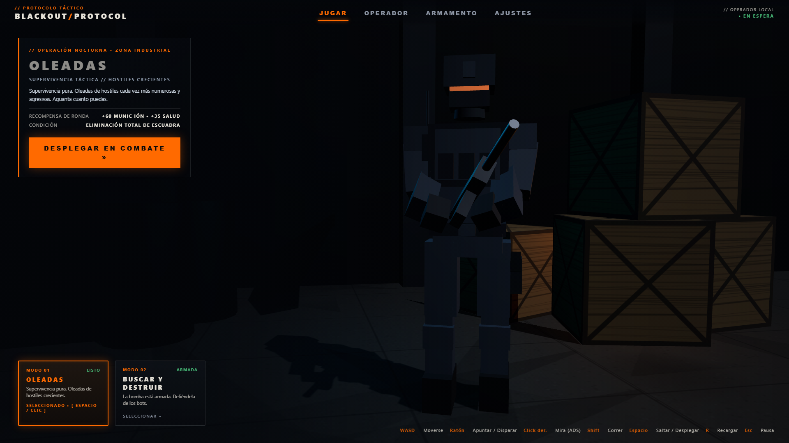
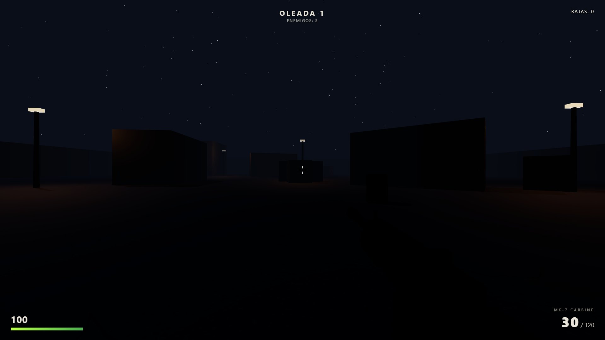
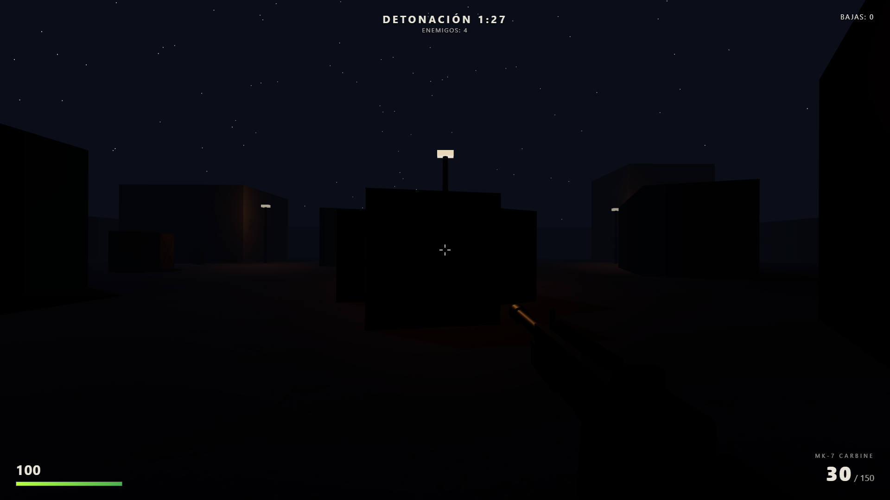
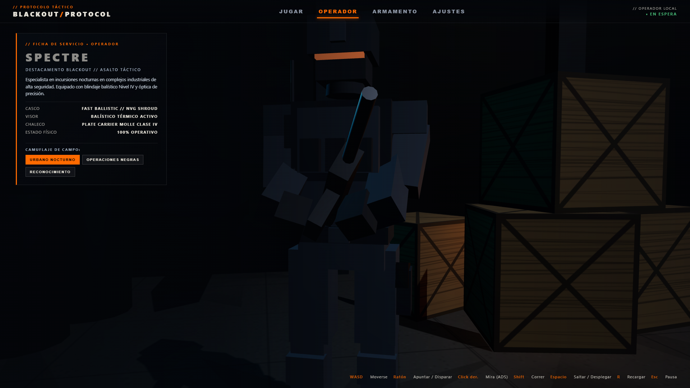
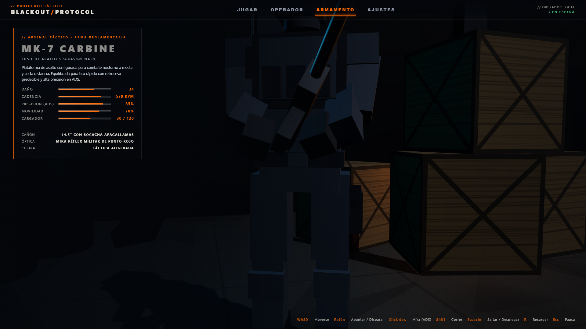
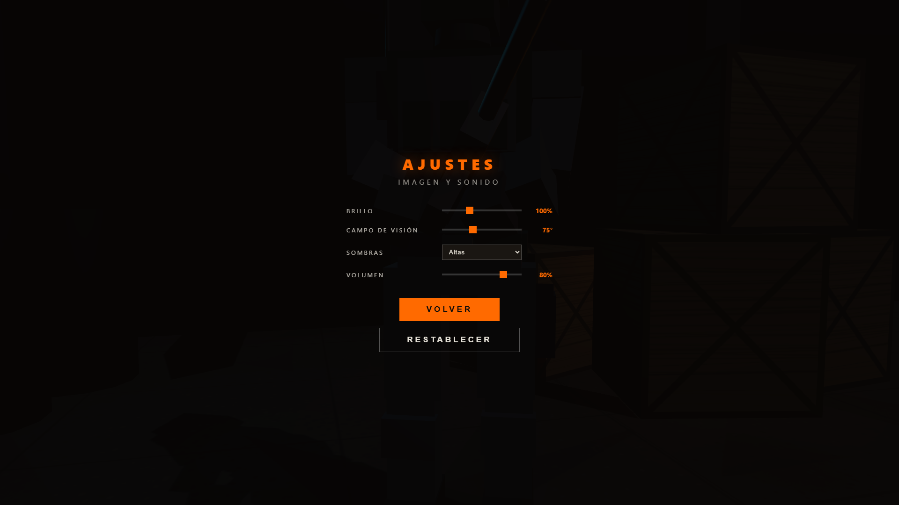

# BLACKOUT PROTOCOL

### Tactical FPS · Browser-Based · Three.js

[](https://github.com/YamiCueto/blackout-protocol-io/releases)
[](https://threejs.org/)
[](https://developer.mozilla.org/en-US/docs/Web/JavaScript/Guide/Modules)
[](https://www.khronos.org/webgl/)
[](https://yamicueto.github.io/blackout-protocol-io/)

---

> ### 🎮 [PLAY BLACKOUT PROTOCOL ONLINE](https://yamicueto.github.io/blackout-protocol-io/)
> **Zero installation required. Instant browser execution via GitHub Pages.**  
> *Compatible with modern Chromium, Firefox, and WebKit desktop browsers with WebGL support.*

---



---

## Overview

**BLACKOUT PROTOCOL** is an experimental tactical first-person shooter built from scratch for modern web browsers. Set inside a hostile industrial complex cloaked in perpetual night, players engage aggressive AI hostiles across tactical combat engagements.

Developed with a strict minimalist architecture, the game is **100% static and client-side**:
- **Zero build steps or bundlers** — runs native JavaScript ES Modules and HTML5.
- **Zero external asset dependencies** — all 3D character models, hangars, industrial architecture, surface textures, and audio effects are generated procedurally at runtime.
- **Zero bloat** — single WebGL renderer and unified simulation loop delivering lightweight, 60 FPS performance.

---

## Current Features (v0.1.0-alpha)

- **Cinematic 3D Tactical Lobby:** Inspired by AAA military titles (*Call of Duty: Warzone*), featuring a procedural military hangar, dynamic rim and fill lighting, real-time idle animations, and smooth camera framing interpolations.
- **Procedural 3D Operator ("Spectre"):** Fully articulated humanoid soldier model featuring a FAST ballistic helmet, NVG mount shroud, tactical goggles with active thermal glow, plate carrier vest with MOLLE magazine pouches, and holster.
- **Real-Time Camouflage Customization:** Switch field camos on the fly in the Operator tab:
  - `URBANO NOCTURNO` — Low-visibility slate urban uniform with red thermal optic.
  - `OPERACIONES NEGRAS` — High-stealth charcoal spec-ops loadout with amber visor.
  - `RECONOCIMIENTO` — Tactical jungle/forest reconnaissance scheme with cyan optic.
- **Ballistic FPS Gunplay:**
  - High-precision Aim-Down-Sights (ADS) with responsive field-of-view zooming.
  - Recoil impulse with procedural weapon recovery.
  - Dynamic spread penalty during hipfire and continuous full-auto fire.
  - Real-time bullet tracers, muzzle flash lighting, and surface spark/decal effects.
- **Hit Feedback System:**
  - Distinct auditory and visual hitmarkers for bodyshots and critical headshots.
  - Animated skull headshot banner for lethal precision eliminations.
  - Dynamic 360-degree directional damage indicator ring tracking enemy fire vectors.
  - Reactive screen flinch and peripheral damage vignette.
- **Synthesized Audio Engine:**
  - 100% procedural sound effects created with the Web Audio API.
  - Synthesized weapon reports, dry-fire mechanical clicks, shell reloads, bullet impacts, and bomb defusal audio.
- **Tactical HUD & Diagnostics:**
  - Minimalist military interface: digital health bar, magazine counter, reserve ammunition, and round/defusal trackers.
  - In-game diagnostics panel (`F3` or `?debug` URL parameter) displaying real-time FPS, draw calls, triangle counts, active geometry allocations, and simulation clock.
- **In-Game Settings Calibration:**
  - Custom display brightness (50% – 200%).
  - Adjustable Field of View (FOV 60° – 100°).
  - Directional shadow map fidelity (`Off`, `Low`, `High`).
  - Master volume slider with instant audio feedback.

---

## Game Modes

BLACKOUT PROTOCOL currently features two distinct combat modes:

### 1. WAVES — Survival Mode
Pure tactical endurance. Squads of AI hostiles infiltrate the industrial perimeter in increasingly numerous and lethal waves. Each completed round provides tactical supply replenishment (+60 ammunition reserve and +35 health).



### 2. SEARCH & DESTROY — Objective Defense
A high-priority explosive device is armed at the center of the industrial courtyard. Hostile bots relentlessly assault the site to neutralize the operator and defuse the payload. Defend the objective until the 90-second detonation countdown concludes, preventing the bots from achieving 10 cumulative seconds of defusal.



---

## Visual Gallery

| Operator Dossier & Camo | Weapon Specifications (MK-7 Carbine) |
| :---: | :---: |
|  |  |
| *Operator dossier with real-time camo switching* | *MK-7 Carbine ballistic stats and attachments* |

| Tactical Settings | Combat HUD & Arena |
| :---: | :---: |
|  |  |
| *Display, FOV, Shadows, and Volume calibration* | *Nighttime industrial arena with streetlights & moon* |

---

## Controls

### Combat Controls

| Input | Action |
|---|---|
| **W, A, S, D** | Move forward / backward / strafe left / strafe right |
| **Mouse Move** | Aim camera (First-Person Look) |
| **Left Click** | Fire weapon |
| **Right Click** | Aim Down Sights (ADS precision zoom) |
| **Left Shift** | Tactical Sprint |
| **Space** | Jump |
| **R** | Reload magazine |
| **Esc** | Pause game / Open tactical menu |

### Lobby & Menu Shortcuts

| Key | Action |
|---|---|
| **Q / E** | Cycle menu tabs left / right (`JUGAR`, `OPERADOR`, `ARMAMENTO`, `AJUSTES`) |
| **1 / 2** or **Left / Right Arrow** | Switch selected mode (`OLEADAS` / `BUSCAR Y DESTRUIR`) |
| **Space** or **Enter** | Deploy into selected combat mission |
| **Esc** | Close settings / Back to menu |

---

## Technology Stack

- **Graphics & Rendering:** [Three.js r160](https://threejs.org/) (WebGL 2.0, `PerspectiveCamera`, PCF soft shadow maps, volumetric fog, procedural mesh generation).
- **Core Architecture:** Vanilla JavaScript (ES2022 Native Modules, single `requestAnimationFrame` dispatcher, zero external build frameworks).
- **Audio Subsystem:** Web Audio API (real-time procedural waveform synthesis, white noise buffers, biquad filtering).
- **User Interface:** Semantic HTML5 and modern CSS3 (CSS Variables, Flexbox, Fixed layers, hardware-accelerated `backdrop-filter`).
- **Testing & Quality Assurance:** Playwright CLI and Chrome DevTools Protocol (CDP) automated test suites.
- **Hosting & Infrastructure:** GitHub Pages (Static HTTPS CDN delivery).

---

## Local Development & Quickstart

Because BLACKOUT PROTOCOL uses native JavaScript ES Modules, modern browser security policies (CORS) require the game to be served over HTTP rather than directly opened via the `file://` protocol.

### 1. Clone the repository
```bash
git clone https://github.com/YamiCueto/blackout-protocol-io.git
cd blackout-protocol-io
```

### 2. Start a local HTTP server
Using Python 3:
```bash
python -m http.server 8000
```
Or using Node.js:
```bash
npx serve .
```

### 3. Open in your browser
Navigate to:
```
http://localhost:8000
```

---

## Project Roadmap

- **v0.1.0-alpha** *(Current)*: First public playable release. 3D tactical lobby, procedural operator, Waves survival mode, Search & Destroy objective defense, procedural audio, and GitHub Pages deployment.
- **v0.2.0-alpha**: Local persistent profile, player progression curve, match performance scoring, and operational career records.
- **v0.3.0-alpha**: Expanded armory catalog introducing new primary and secondary weapon platforms (submachine gun, marksman rifle, sidearm).
- **v0.4.0-alpha**: Custom loadout builder with selectable primary/secondary slots and tactical equipment.
- **v0.5.0-alpha**: Weapon attachment system (muzzle devices, optical sights, extended magazines, tactical stocks).
- **v0.6.0-alpha**: Advanced AI combat behaviors (flanking maneuvers, cover utilization, adaptive aggression).
- **v1.0.0**: Stable full release candidate.

---

## Alpha Notice & Known Considerations

This project is currently in early **Alpha (v0.1.0-alpha)** development:
- **Pointer Lock Security:** Browsers require an explicit user click gesture before granting raw mouse capture. If pointer lock fails, click anywhere on the canvas or press `Escape` to toggle the pause menu and retry.
- **Hardware Acceleration:** Optimal performance (60 FPS) requires WebGL hardware acceleration enabled in browser settings.
- **Multiplayer Scope:** BLACKOUT PROTOCOL is currently a single-player tactical simulation against AI hostiles; online multiplayer is not implemented in this phase.

---

## Author

- **Yamid Cueto**  
  GitHub: [@YamiCueto](https://github.com/YamiCueto)  
  Repository: [blackout-protocol-io](https://github.com/YamiCueto/blackout-protocol-io)

---

## License

Copyright © 2026 Yamid Cueto. All rights reserved.  
A formal open-source distribution license has not yet been defined for this pre-release alpha build.
