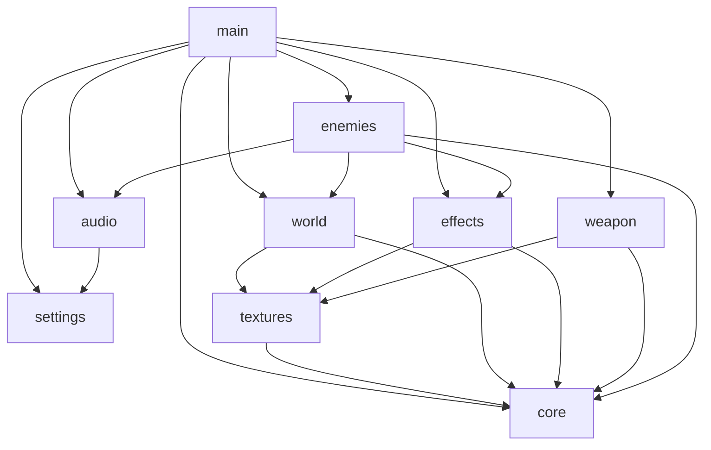
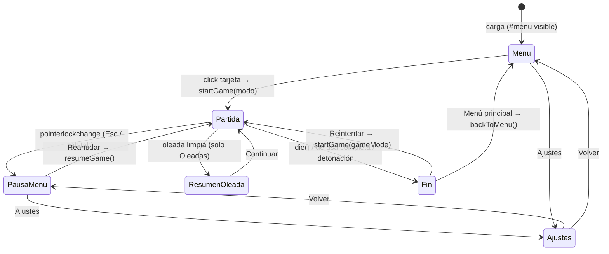
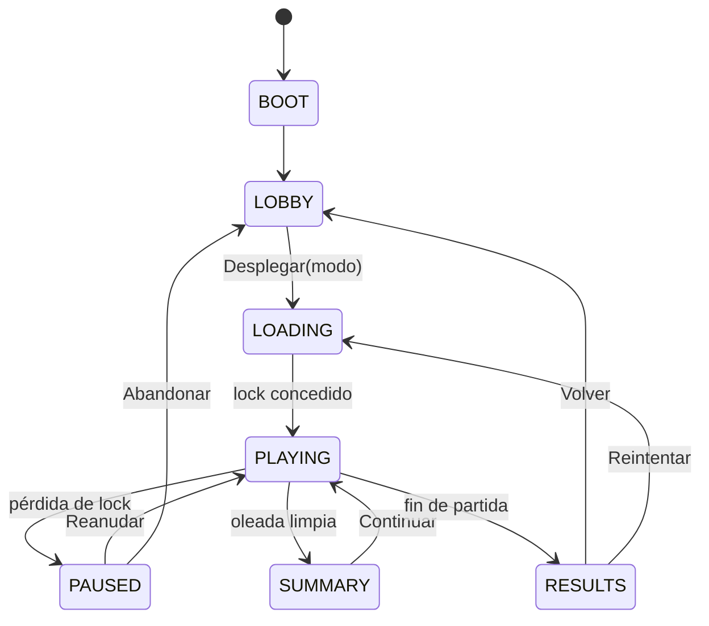

# BLACKOUT PROTOCOL — Auditoría base (Fase 0)

- Fecha de la auditoría: 2026-11-10
- Alcance: análisis exclusivamente. No se modificó código fuente, configuración ni Git. Las únicas escrituras son este documento y `GEMINI_CONTEXT_HANDOFF.md`.
- Ruta del proyecto: `c:\Users\YAMI\projects\game`

**Convención de evidencia** usada en todo el documento:

| Etiqueta | Significado |
|---|---|
| `[CÓDIGO]` | Confirmado leyendo el código del repositorio (se cita archivo y líneas). |
| `[THREE r160]` | Confirmado leyendo el código fuente de three.js r160 (descargado en memoria desde la CDN que usa el proyecto; no se escribió a disco). |
| `[HIPÓTESIS]` | Inferencia razonable que **no** se ha demostrado ejecutando el juego. |
| `[NO MEDIDO]` | Afecta al rendimiento pero no existe ninguna métrica. No se afirma ningún valor de FPS. |

---

## 1. Resumen ejecutivo

BLACKOUT PROTOCOL es un FPS de navegador pequeño (≈1 460 líneas de JS, 126 de CSS, 183 de HTML) hecho con **JavaScript vanilla en módulos ES + Three.js r160 cargado desde CDN**, sin build, sin `package.json`, sin pruebas y **sin ningún commit en Git** (todo está sin seguimiento).

Conclusiones principales:

1. **Se puede iniciar, reiniciar, abandonar y cambiar de modo sin recargar la página.** Existen `startGame(mode)`, `backToMenu()` y `resumeGame()` (`js/main.js` L419-462, L489-507) y todos los listeners se registran una sola vez al importar el módulo. La respuesta es **sí, con salvedades** (limpieza incompleta de recursos y estado, ver hallazgos).
2. **El motor 3D es de escena única y global.** `renderer`, `scene` y `camera` son singletons creados al importar `js/core.js`; `js/world.js` construye todo el escenario como efecto secundario de su importación. Un lobby 3D es viable con **un único renderer y una segunda `Scene`/`Camera`**, no con un segundo renderer.
3. **El cuello de botella arquitectónico es `js/main.js`** (798 líneas, 0 exports): jugador, entrada, IA, reglas de ambos modos, HUD, pantallas y bucle viven ahí con estado de módulo privado. No existe contrato de modo, máquina de estados ni gestor de pantallas.
4. **El menú actual es reemplazable, pero con un contrato rígido de 50 IDs DOM** que `main.js` resuelve con `getElementById` al importar; si falta uno, el módulo lanza `TypeError` y el juego no arranca.
5. **No hay hallazgos CRITICAL.** Hay 3 HIGH: ausencia de línea base en Git, `main.js` monolítico sin API, y cadáveres de enemigos que nunca se eliminan en Oleadas.
6. **No se ejecutó el juego en un navegador ni se tomó ninguna métrica.** Todo lo relativo a rendimiento son problemas *detectados en el código*, no demostrados.
7. Existen discrepancias con la descripción del producto: hay **un solo escenario** y **una sola arma**; "Armamento", "Operador" y "Estadísticas" no tienen sistema de respaldo hoy.

**Recomendación de primer sprint:** "Línea base y estabilización" — commit base (con autorización del usuario), instrumentación de métricas (`renderer.info`), corrección de ciclo de vida (cadáveres, recursos, Pointer Lock, reset de entrada, reloj único, salida desde pausa) **sin tocar mecánicas** salvo lo aprobado explícitamente. Detalle en §14 y §16.

---

## 2. Inventario tecnológico

| Aspecto | Hallazgo | Evidencia |
|---|---|---|
| Lenguaje | JavaScript vanilla (ES2020+). **No hay TypeScript.** | Solo `*.js` en `js/`; sin `tsconfig`. |
| Módulos | ES modules nativos con `importmap` | `index.html` L178-181 |
| Three.js | r160 (`three@0.160.0`) desde `cdn.jsdelivr.net`, versión fijada, **sin SRI, sin copia local** | `index.html` L179; `REVISION = '160'` en la CDN |
| Three addons | **No** hay mapeo `three/addons/` (sin `GLTFLoader`, `OrbitControls`, `EffectComposer`, etc.) | `importmap` solo mapea `three` |
| Build / bundler | **Ninguno** (sin Vite, webpack, etc.) | No existe `package.json` ni config |
| Dependencias npm | **Ninguna** | No existe `package.json` / `node_modules` |
| Física | **Ninguna librería.** Colisión propia: círculo vs AABB (`pushOutCircle`), raycast de three | `js/world.js` L149-179 |
| Audio | WebAudio propio y 100 % procedural (sin ficheros) | `js/audio.js` |
| Animación | **Sin `AnimationMixer`.** Animación manual por rotaciones/posiciones en `tick()`; HUD con CSS `transition`/`@keyframes` | `js/main.js` L610-628, L663-667; `css/style.css` L47-57 |
| Gestión de estado | **Ninguna librería.** Variables `let` de módulo en `main.js` + objetos exportados (`settings`, `weapon`, `enemies`) | `js/main.js` L69-79, L235-249 |
| Texturas | Procedurales con canvas 2D (`CanvasTexture`) | `js/textures.js` |
| Assets estáticos | **Ninguno** (sin imágenes, modelos, audio, fuentes web) | Árbol de ficheros |
| Persistencia | `localStorage` clave `bp_settings` solo para ajustes | `js/settings.js` L2-14 |
| Pruebas | **Ninguna** | No hay carpeta/config de tests |
| Lint/format/CI | **Ninguno** | Sin `.eslintrc`, `.github/`, etc. |
| Scripts | **Ninguno** (el README sugiere `python -m http.server 8000`) | `README.md` |
| Despliegue | Estático / GitHub Pages (según README) | `README.md` |
| Git | Rama `master`, **sin commits**; `README.md`, `css/`, `index.html`, `js/` sin seguimiento; sin remoto; sin `.gitignore` | `git status`, `git log`, `git config` |
| Entorno de la auditoría | Node v24.19.0, Python 3.14, Git 2.56 disponibles. Verificación de sintaxis ES-module de los 9 `.js`: **OK** | `vm.SourceTextModule` |

---

## 3. Estructura del proyecto

```
game/
├── index.html            (183 L) Shell: <canvas id="c">, HUD, 4 pantallas, importmap, <script type=module>
├── README.md             (849 B) Cómo jugar/desplegar y controles
├── css/
│   └── style.css         (126 L) Estilos de HUD, pantallas, tarjetas de modo, ajustes
└── js/
    ├── core.js           ( 26 L) renderer, scene, camera, helper $, listener de resize
    ├── settings.js       ( 14 L) settings + persistencia localStorage
    ├── audio.js          ( 88 L) AudioContext lazy, bus maestro, sfx procedurales
    ├── textures.js       ( 96 L) makeCanvas + texturas procedurales
    ├── world.js          (183 L) luces, escenario, colisión AABB, solidMeshes()
    ├── weapon.js         ( 53 L) Estado y modelo del arma (MK-7), fogonazo
    ├── enemies.js        ( 99 L) Modelo de enemigo, daño, headshot, LOS, clearEnemies
    ├── effects.js        (103 L) Trazadoras, partículas, decals, escombros
    └── main.js           (798 L) Orquestador: TODO lo demás
```

Total JS: 1 460 líneas; `main.js` concentra el 55 %.

### Responsabilidades y API exportada

| Archivo | Exports | Efectos secundarios al importar |
|---|---|---|
| `core.js` | `$`, `renderer`, `scene`, `camera` | Crea `WebGLRenderer` sobre `#c`, `Scene`, `PerspectiveCamera`; `scene.add(camera)`; registra `resize` (L22-26) |
| `settings.js` | `SETTINGS_DEFAULTS`, `settings`, `saveSettings` | Lee `localStorage` |
| `audio.js` | `audio`, `applyVolume`, `sfxShot`, `sfxClick`, `sfxReload`, `sfxHit`, `sfxHurt`, `sfxExplosion`, `sfxEnemyShot` | Ninguno (AudioContext se crea en la primera llamada a `audio()`) |
| `textures.js` | `makeCanvas`, `texAsphalt`, `texConcrete`, `texMetal`, `texCrate`, `flashTex`, `sparkTex`, `decalTex` | Genera 7 texturas (usa `renderer.capabilities`) |
| `world.js` | `ARENA`, `colliders`, `moon`, `pushOutCircle`, `pointBlocked`, `solidMeshes` | **Construye todo el escenario en `scene`** y marca sólidos (L141-146) |
| `weapon.js` | `GUN_HIP`, `GUN_ADS`, `weapon`, `gunGroup`, `muzzleFlash`, `flashSprite` | `camera.add(gunGroup)` |
| `enemies.js` | `enemies`, `makeEnemy`, `damageEnemy`, `enemyLOS`, `clearEnemies` | Crea 5 materiales compartidos y un `Raycaster` |
| `effects.js` | `spawnTracer`, `spawnBurst`, `spawnDecal`, `spawnDebris`, `updateEffects`, `resetEffects` | Ninguno |
| `main.js` | **ninguno** | Resuelve ~50 IDs DOM, registra todos los listeners, arranca `tick()` |

Grafo de dependencias (sin ciclos):



---

## 4. Arquitectura actual

**Patrón:** "módulos de dominio + un orquestador monolítico". Los módulos pequeños (`world`, `enemies`, `weapon`, `effects`, `audio`) están razonablemente aislados; toda la lógica de juego, estados y UI está en `main.js`.

### Estado global y acoplamientos

| Estado | Dónde | Observación |
|---|---|---|
| `renderer`, `scene`, `camera` | `core.js` (singletons exportados) | Todo el motor asume una sola escena y una sola cámara |
| `enemies[]` | `enemies.js` | Mutado desde `main.js` (lectura/iteración) y `enemies.js` |
| `weapon` | `weapon.js` | Objeto mutable único: no hay concepto de inventario ni de varias armas |
| `settings` | `settings.js` | Objeto mutable; persistido al instante |
| `colliders[]` | `world.js` | Se llenan al importar; no hay API para recargar el mapa |
| `player`, `keys`, `locked`, `paused`, `mouseDown`, `adsDown`, `adsAmount` | `main.js` L69-79 | Privados al módulo |
| `wave`, `kills`, `waveDelay`, `betweenWaves`, `inSummary`, `waveStats`, `waveStartT` | `main.js` L235-242 | Reglas de Oleadas mezcladas con estado general |
| `gameMode`, `snd`, `bombGroup`, `bombLight`, `bombPos` | `main.js` L245-249 | Reglas de Buscar y Destruir |
| `flashTimer`, `shake`, `hitFlash`, `bobT` | `main.js` L168, L517 | Cámara/efectos de impacto |
| `dmgIndicators[]` | `main.js` L136 | DOM dinámico en `#dmg-indicators` |

**Acoplamientos importantes**

- `main.js` escribe en el DOM directamente desde la lógica de juego (`shoot`, `damagePlayer`, `tick`, `spawnWave`): HUD no está desacoplado.
- La IA de movimiento y disparo está **dentro de `tick()`** (L608-710), bifurcada por `gameMode === 'snd'`; `enemies.js` solo contiene modelo/daño/LOS (su cabecera lo dice, L1).
- `enemies.js` depende de `world.js`, `effects.js` y `audio.js`; `makeEnemy` añade a la `scene` global y al array global (L45-46), por lo que **no puede reutilizarse para dibujar un personaje en otra escena** sin refactor.
- El panel `#wave-panel` del HUD se reutiliza como temporizador en Buscar y Destruir (`main.js` L447, L731).

### Preguntas de la auditoría sobre el sistema

| Sistema | Dónde vive | Comunicación |
|---|---|---|
| Movimiento | `main.js` L525-546 | Lee `keys`, escribe `player` |
| Cámara FPS | `main.js` L567-580 (yaw/pitch en L88-93) | Escribe `camera.position/rotation` |
| Controles | `main.js` L81-103 | Listeners globales en `window`; `keys[e.code]` |
| Pointer Lock | `main.js` L84-87, L460, L493, L363 | `pointerlockchange` → pausa |
| Disparo | `main.js` L170-226 | Raycaster global; lee `weapon`, `enemies`, `solidMeshes()` |
| Arma/munición/recarga | `weapon.js` (estado), `main.js` L228-232, L553-565 | Objeto `weapon` mutable |
| Salud/daño | `main.js` L406-416 | `player.hp`, indicadores DOM, `die()` |
| Enemigos | `enemies.js` + IA en `main.js` | Array global |
| Colisiones | `world.js` L149-179 | AABB `Box3[]`; el jugador y los enemigos usan `pushOutCircle` |
| Estados de partida | Booleanos sueltos: `paused`, `locked`, `inSummary`, `player.alive`, `betweenWaves`, `snd.ended` | **Sin máquina de estados** |
| Victoria/derrota | `main.js` L464-480, L296-313, L771-781 | Funciones directas |
| Reinicio | `main.js` L419-462, L511 | `startGame(gameMode)` |
| Pausa | `main.js` L482-494 | Vía pérdida de Pointer Lock (no hay handler de `Escape`) |

---

## 5. Ciclo de vida del juego

### 5.1 Arranque

1. `index.html` carga `js/main.js` como módulo (L181).
2. Importaciones en orden: `core` (crea renderer/escena/cámara) → `settings` → `audio` → `world` (importa `textures`, construye escenario) → `effects` → `weapon` → `enemies`.
3. `main.js` evalúa: resuelve IDs DOM, registra listeners (L35-66, L81-103, L357, L509-513).
4. Final (L795-798): `applySettings()`, `refreshSettingsUI()`, oculta `#loading`, llama `tick()`.
5. Estado inicial: `paused = true`, `player.alive = false`; `#menu` visible por CSS (`.screen` es `display:flex`; no tiene `display:none`).

### 5.2 Bucle

`tick()` (L520-793) se reprograma a sí mismo con `requestAnimationFrame` en su primera línea (L521). Se invoca **una única vez** (L798) y `startGame` no lo llama → **no hay bucles duplicados** `[CÓDIGO]`. El id del `rAF` no se guarda, por lo que **el bucle no puede cancelarse**.

- Simulación: solo si `!paused && player.alive` (L524).
- **Siempre**, incluso en menú/pausa/resultados: `updateEffects(dt)` y `renderer.render(scene, camera)` (L791-792).

### 5.3 Transiciones de estado actuales



Notas: la pantalla de pausa **no tiene** "abandonar partida" (hallazgo F-006). `#menu` hace de menú principal **y** de pausa: se alternan `#modes` y `#resume-btn` con estilos inline (L482-488, L495-507).

### 5.4 Pregunta fundamental: ¿iniciar/detener/reiniciar/cambiar de modo sin recargar?

**Sí.** Evidencia:

| Capacidad | Referencia |
|---|---|
| Iniciar | `startGame(mode)` L419-462, enlazado a `#mode-waves` y `#mode-snd` (L509-510) |
| Reiniciar | `#retry-btn` → `startGame(gameMode)` (L511) |
| Detener / volver a menú | `backToMenu()` L495-507 → `#menu-btn` (L513). Solo desde la pantalla de fin |
| Cambiar de modo | `backToMenu()` y luego `startGame('otro')`; `startGame` reinicia `gameMode`, `snd`, bomba, enemigos y efectos |
| Sin duplicar listeners | `startGame` no llama `addEventListener`; los handlers `.onclick =` son asignaciones únicas |
| Sin duplicar bucle | `tick()` solo se invoca en L798 |
| Limpieza ejecutada | `clearEnemies()` (`enemies.js` L96-99), `resetEffects()` (`effects.js` L96-103), `clearDamageIndicators()`, `removeBomb()` |

**Salvedades** (no impiden la reutilización pero se acumulan al encadenar partidas):
- `clearEnemies` y `removeBomb` **no liberan** geometrías/materiales (F-004).
- `startGame` no resetea `adsAmount`, `mouseDown`, `adsDown`, `flashTimer`, `shake`, `bobT`, `weapon.cooldown`, transformaciones de `gunGroup`, ni los decals (F-010, F-019).
- No existe método para detener una partida en curso desde la pausa (F-006).

---

## 6. Sistemas implementados (con evidencia)

| Sistema | Estado real |
|---|---|
| Movimiento | WASD, Shift correr (8.2 vs 5.2), Espacio salto (v=6.5, g=19), aceleración suave (`main.js` L525-546) |
| Cámara FPS | Euler `YXZ`, sensibilidad fija 0.0021 (L90-91), balanceo, retroceso, sacudida aleatoria (L567-580), ADS reduce FOV 25° (L548-551) |
| Pointer Lock | `requestPointerLock` en `startGame`/`resume`/`continue`; pausa por `pointerlockchange`. **No** hay `pointerlockerror` ni handler de `Escape` |
| Disparo | Hitscan con dispersión (L179-185), daño 34 (×2.2 headshot, L207), trazadoras, decals, hitmarker |
| Arma | **Una sola**: "MK-7 Carbine" — cargador 30, reserva 120 (150 en S&D), cadencia 0.105 s, recarga 1.7 s (`weapon.js` L9-13). `#weapon-name` es texto estático (`index.html` L20). No hay cambio de arma |
| Salud | 100, sin regeneración; +35 al limpiar oleada (L718). Viñeta/flash/indicadores direccionales |
| Daño al jugador | Hitbox de 3 esferas (cabeza ×1.5, torso ×1.0, piernas ×0.7), `main.js` L112-133; daño enemigo `(7+rand*6+lvl)*mult` (L698) |
| Enemigos | Modelo procedural de cajas (10 meshes), HP 100 base, velocidad 2.4-3.6, headshot con desmembramiento de cabeza (`popHead`) |
| IA | Máquina implícita dentro de `tick()`: avanzar si dist>11, retroceder si <6, esquivar lateral (L636, L651-668); disparo si dist<38 y hay LOS (L672-709). **Sin pathfinding**: solo dirección recta + `pushOutCircle` |
| Colisiones | AABB estático (`colliders`), círculo vs AABB; bounds en `ARENA ± 1` |
| Escenarios | **Uno solo** (`ARENA = 58`, naves, contenedores, cajas, 5 farolas). No hay selección de mapa |
| Audio | Efectos procedurales, bus maestro con volumen; **sin música ni ambiente** |
| HUD | Salud, munición, oleada/temporizador, enemigos restantes, bajas, barra de desactivación, mensaje, hitmarker, banner de headshot |
| Estadísticas | `waveStats` (disparos, impactos, bajas, headshots, daño, tiempo) solo por oleada; **nada se persiste** |
| Pausa | Flag `paused`; el HUD se oculta y se muestra `#menu` con Reanudar |
| Persistencia | Solo ajustes (`bp_settings`): brillo, FOV, sombras, volumen |

Elementos mencionados en el brief y **no encontrados** en el código: selección de mapa, varias armas, inventario, operador/personaje visible, kill feed, progresión/XP, música, controles táctiles, remapeo de teclas, sensibilidad configurable.

---

## 7. Estado real de cada modo

### 7.1 OLEADAS (`gameMode === 'waves'`)

| Aspecto | Implementación |
|---|---|
| Inicialización | `startGame('waves')` L450-453: pos `(0,1.7,40)`, yaw π, `betweenWaves=true`, `waveDelay=2.5` |
| Generación | `spawnWave()` L315-337: `n = 3 + 2·wave` enemigos en bordes aleatorios, ≥20 m del jugador, hasta 24 intentos |
| Progresión | Cuando `!betweenWaves && !anyAlive` (L714): +60 reserva, +35 HP (máx 100), `showWaveSummary()`; tras "Continuar" `waveDelay=1.5` |
| Dificultad | HP `100+(wave-1)·12`; velocidad `+min(wave·0.12, 1.4)`; cadencia enemiga `-min(wave·0.04, 0.5)`; error de puntería `-min(wave·0.05, 0.45)`; daño `+wave`. **Sin tope en el número de enemigos** |
| Victoria | **No existe** (supervivencia infinita) |
| Derrota | `player.hp ≤ 0` → `die()` → "K.I.A." con oleada y bajas (L475-480) |
| Reinicio | `startGame(gameMode)` desde `#retry-btn` |
| Estado persistente entre oleadas | Cadáveres permanecen en `enemies[]` y en `scene` (F-003); `wave`, `kills` continúan; `waveStats` se reinicia por oleada |
| Dependencias compartidas | `player`, `weapon`, `enemies`, HUD (`#wave-num`, `#enemies-left`), `#wave-summary` |

### 7.2 BUSCAR Y DESTRUIR (`gameMode === 'snd'`)

| Aspecto | Implementación |
|---|---|
| Rol del jugador | Defender una bomba **ya armada**; los bots intentan desactivarla. El jugador **no tiene acción sobre la bomba** (no existe interacción) |
| Inicialización | `startGame('snd')` L440-448: pos `(0,1.7,18)`, yaw 0 (mira a la bomba), reserva 150, `snd = {timeLeft:90, defuse:0, spawnTimer:1, ...}`, `createBomb()` |
| Objetivo | Bomba en `bombPos = (0,0,-6)` (L248), con luz roja parpadeante y pitido que se acelera (L733-738) |
| Temporización | `SND_DURATION = 90` s (L246), descontados con `dt` (L730) |
| Bots | Aparecen hasta que haya 9 vivos (L743); 4 al principio, luego 1 (65 %) o 2 (35 %) cada 4.5-7.5 s (L744, L747). Van en línea recta a la bomba (L637-649). A <2.3 m quedan quietos "desactivando" (L640-645) y **no disparan mientras desactivan** (L672). Fuera de la bomba disparan al jugador si hay LOS |
| Escalado | HP `100 + elapsed·0.8`, velocidad `+min(elapsed·0.02, 1.2)` (L286-288), `lvl = min(elapsed/20 s, 4)` para puntería/daño (L678) |
| Estados del objetivo | Implícitos: *armada* (`bombGroup` existe) → *detonada* (`detonateBomb`) o *desactivada* (`removeBomb` + derrota). No hay enum |
| Desactivación | `defuse += dt·(1+(n-1)·0.5)` con n bots activos; si ninguno, decae a `0.6·dt` (L751-762). `SND_DEFUSE_TIME = 10` s |
| Victoria | `snd.timeLeft ≤ 0` → `detonateBomb()` (explosión, mata a hostiles en radio 30) → tras 1 600 ms `showEndScreen(true, 'OBJETIVO CUMPLIDO')` si `player.alive` (L296-313, L778-781) |
| Derrota | (a) `die()` por HP; (b) `snd.defuse ≥ 10` → "BOMBA DESACTIVADA / MISIÓN FALLIDA" (L771-776) |
| Reinicio | `startGame('snd')` (`removeBomb` + `createBomb` en cada partida) |
| Dependencias compartidas | Mismo bucle, jugador, arma, HUD (`#wave-num` como temporizador), `#death-screen` para resultado |

### 7.3 ¿Existe interfaz o contrato común para los modos?

**No.** Los modos son ramas `if (gameMode === ...)` en `startGame` (L440-454), `tick` (L637, L678, L712-782) y `die` (L476-478). No hay objeto/clase de modo, ni hook de `start/update/end`, ni constantes exportadas.

**Contrato propuesto para una fase posterior (no implementado):**

```
GameMode {
  id, label, description, rules[]            // metadatos para tarjetas y panel lateral
  start(ctx)                                 // reinicia estado propio, coloca al jugador
  update(dt, ctx)                            // spawns, objetivos, condiciones
  navTarget(enemy, ctx)                      // reemplaza el if de IA (jugador vs bomba)
  hud(ctx) → { title, subtitle, extra }      // elimina la escritura directa en #wave-num
  result() → { victory, title, stats }       // para pantalla de resultados y estadísticas
  dispose(ctx)                               // libera bomba, cadáveres, timers
}
ctx = { player, weapon, enemies, spawnEnemy(), flashMsg(), events }
```

---

## 8. Análisis de interfaz

### 8.1 Mapa de pantallas

| Pantalla | Elemento | Visibilidad inicial | Cómo se muestra/oculta |
|---|---|---|---|
| Carga | `#loading` (z 20) | visible | `style.display='none'` (L797) |
| Menú principal / Pausa | `#menu` (`.screen`, z 10) | visible (flex) | Inline `display` en L55, L61, L456, L486, L506. Pausa: oculta `#modes`, muestra `#resume-btn` |
| Ajustes | `#settings-screen` | `display:none` (CSS L108) | L56/L60. **"Volver" siempre muestra `#menu`** (L59-62) |
| Fin de partida | `#death-screen` | oculta (CSS L122) | `showEndScreen` L464-473; clase `.victory` para victoria |
| Resumen de oleada | `#wave-summary` | oculta (CSS L101) | `showWaveSummary` L339-355 / `continue-btn` L357-364 |
| HUD | `#hud` + `#damage-vignette` + `#hit-flash` | `#hud` oculto (CSS L10) | `style.display` en L353, L360, L458, L471, L487, L503 |

El apilado depende de `z-index` y orden del DOM; no existe gestor de pantallas. `#menu` tiene fondo **opaco** (`radial-gradient` L72-73): el canvas queda totalmente tapado tras él; `#wave-summary` (0.9) y `#settings-screen` (0.88) son semitransparentes.

### 8.2 Respuestas a los 8 puntos solicitados

1. **Mostrar/ocultar menú:** asignaciones directas a `style.display` repartidas por `main.js`.
2. **Iniciar partida:** click en `#mode-waves` / `#mode-snd` → `startGame(modo)` (L509-510), que oculta menú, muestra HUD y pide Pointer Lock (L456-460).
3. **Seleccionar modo:** la tarjeta ya *es* el botón de inicio; no hay paso intermedio "seleccionar → confirmar".
4. **Eventos:** `onclick`/`oninput`/`onchange` (una sola asignación por elemento) + listeners globales en `window`/`document`.
5. **Administración de pantallas:** manual, sin abstracción.
6. **Separación UI/lógica:** **no existe**; `main.js` mezcla ambas.
7. **HUD desacoplado:** **no**; se escribe desde lógica (`updateHUD` L392-404, `shoot` L212, `spawnWave` L317, `tick` L731/L786).
8. **¿Se puede reemplazar el menú sin alterar el motor?** Sí para el *aspecto* (HTML/CSS) si se conservan los IDs. No sin tocar `main.js` si cambia la navegación (L54-66 y L509-513 están en `main.js`). El motor 3D (`core`, `world`, `enemies`, `effects`, `weapon`) no depende del menú.

### 8.3 Conflictos DOM ↔ controles

| Tema | Observación |
|---|---|
| Pointer Lock | El lock se pide siempre sobre `renderer.domElement` dentro de handlers de click (user gesture). La pausa nace de `pointerlockchange` (L84-87); **no hay handler de `pointerlockerror`** (F-008) |
| Teclado | `keydown`/`keyup` globales en `window` registran `keys[code]` siempre, incluso en menús (L81-82). No hay manejo de `blur`/`visibilitychange` (F-010). **No hay handler de `Escape`**: la pausa depende del comportamiento del navegador al salir de Pointer Lock |
| Tecla R | `tryReload()` solo comprueba `player.alive` (L229); en pausa/resumen activa `reloading` y `sfxReload` aunque no avance el temporizador (F-018) |
| Ratón | `mousedown`/`mousemove` requieren `locked` (L89, L95); `mouseup` no |
| Menú contextual | `contextmenu` global con `preventDefault` (L103), también en menús |
| Foco | Tarjetas de modo son `div` sin `tabindex`/`role` → no accesibles por teclado (F-020). Los `button`/`select`/`range` sí son focusables; el teclado de juego (Espacio) podría activar un botón enfocado si estuviera visible `[HIPÓTESIS]` |
| Diseño adaptable | `css/style.css` **no contiene `@media`**; solo `clamp()` en `h1` y `flex-wrap` en tarjetas. Juego solo apto para escritorio (Pointer Lock + teclado) |

---

## 9. Análisis del motor Three.js

| # | Aspecto | Hallazgo |
|---|---|---|
| 1 | Renderer | `core.js` L6-13: `WebGLRenderer({canvas:#c, antialias:true})`, `setPixelRatio(min(dpr,2))`, ACES filmic, exposición `1.15·brillo/100` (aplicada en `applySettings` L13), `SRGBColorSpace`, `PCFSoftShadowMap`, sombras habilitadas. Único |
| 2 | Escenas | Una `Scene` (`core.js` L15) con fondo y `FogExp2(0x0a0e18, 0.016)` |
| 3 | Cámaras | Una `PerspectiveCamera(75, aspect, 0.08, 400)` añadida a la escena (L19-20). `gunGroup` es hijo de la cámara |
| 4 | Iluminación | En `world.js`: hemisférica (L17), direccional "luna" con sombra (L19-27), 5 `PointLight` de farolas (L134); además `PointLight` del fogonazo (siempre presente, intensidad 0; `weapon.js` L41), + `PointLight` de la bomba en S&D (`main.js` L263). **6 point lights en el arranque y 7 en S&D** `[CÓDIGO]` |
| 5 | Sombras | Solo la luna proyecta (L21). Cámara ortográfica ±70, `far=180`, `bias -0.0004`; mapa 2048 (Altas) / 1024 (Bajas) / `castShadow=false` (Off) (`main.js` L16-21). El renderer mantiene `shadowMap.enabled=true` aun en "Off". `autoUpdate` por defecto → el mapa se re-renderiza **cada fotograma** |
| 6 | Materiales | Estándar PBR con texturas procedurales; enemigos comparten 5 materiales (`enemies.js` L10-14); mundo comparte materiales por tipo; partículas/decals/trazadoras crean material por instancia |
| 7 | Geometrías | Cajas por objeto; barriles comparten geometría (L111); **cada enemigo crea 8 `BoxGeometry` nuevas** (L18-30) aunque son idénticas |
| 8 | Animaciones | Manuales (piernas de enemigos, muerte, arma). Sin `AnimationMixer` |
| 9 | Ciclo de render | `requestAnimationFrame` → `renderer.render(scene, camera)` incondicional (L792) |
| 10 | Actualización por fotograma | `dt = min(clock.getDelta(), 0.05)` (L522). Simulación gated por `paused/alive` (L524) |
| 11 | Recursos GPU | Sin gestor central; liberación puntual en `effects.js` (trazadoras, decals, partículas, escombros) |
| 12 | Limpieza | Correcta en efectos; **ausente** en enemigos y bomba (F-004). Las texturas procedurales son permanentes (no es problema: se crean una vez) |
| 13 | Resize | `core.js` L22-26: actualiza aspect y `setSize`. No reajusta `setPixelRatio` ni está preparado para varias cámaras |
| 14 | Control de rendimiento | Tope de `devicePixelRatio` a 2, setting de sombras, límite de 60 decals, `dt` acotado. No hay adaptación dinámica, ni contadores (`renderer.info`), ni LOD, ni pooling |

### 9.1 ¿Permite una escena 3D independiente para el lobby?

**Sí**, con condiciones:

- `renderer` es exportado y reutilizable. three.js permite `renderer.render(otraScene, otraCamera)` con el mismo renderer en el mismo bucle.
- **Reutilizar el renderer es preferible a crear otro** `[THREE r160]`: las texturas procedurales se crean con `renderer.capabilities` (`textures.js` L12); en three.js las cachés de GPU (texturas, geometrías, programas) pertenecen a cada renderer, así que un segundo renderer duplicaría subidas de texturas/shaders y consumiría otro contexto WebGL (los navegadores limitan los contextos activos). Un único renderer también conserva tone mapping, color space y sombras coherentes entre lobby y partida.
- Limitaciones actuales para una segunda escena: (a) `world.js` se ejecuta al importar y escribe en la `scene` global, no hay fábrica; (b) el bucle renderiza siempre la escena de juego; (c) `fog` y `background` son por escena (bien); (d) `gunGroup` cuelga de la cámara de juego, no aparecerá en otra cámara (bien); (e) `texAsphalt.repeat.set(22,22)` está en la textura (L36), por lo que el lobby debe clonar o crear texturas propias para otro `repeat`.
- Exposición/brillo y calidad de sombras (`settings`) son del renderer/luces: el lobby las heredaría automáticamente en `toneMappingExposure`, pero las luces de sombra del lobby deberían consultar `settings.shadows` por separado.

### 9.2 Riesgos técnicos (código vs. demostrado)

| Riesgo | Estado |
|---|---|
| Fugas de memoria GPU | **Detectadas en código**: geometrías de enemigos y bomba sin `dispose()` (F-004). three.js exige `dispose()` manual (documentación oficial *How to dispose of objects*; en r160 `WebGLGeometries` registra el listener del evento `dispose` por geometría y solo libera buffers al recibirlo — L17395-17458). `[NO MEDIDO]`: no se ha comprobado `renderer.info.memory` |
| Bucles de animación duplicados | **No** existen hoy (solo L798 invoca `tick()`). Riesgo **futuro** si el lobby añade su propio `requestAnimationFrame` |
| Listeners duplicados | **No** existen hoy (registro único al importar). Riesgo futuro si un `LobbyManager` registra/quita listeners por visita |
| Acumulación de geometrías | Sí: cadáveres no eliminados en Oleadas y geometrías de cada enemigo sin compartir (F-003, F-004) |
| Texturas sin liberar | No relevante hoy (se crean una vez). Relevante si se cargan modelos/texturas del operador |
| Cambios de escena defectuosos | No hay gestor de escenas; añadir luces dinámicas (bomba) cambia el número de luces: `numPointLights` forma parte de la clave de programa (`[THREE r160]` L21000) → posible compilación de shaders la primera vez `[HIPÓTESIS]` en cuanto a duración |
| Pérdida de contexto WebGL | three.js r160 registra `webglcontextlost` y `webglcontextrestored` (L28648, L29090-29112: `preventDefault`, reinicialización). **El proyecto no añade UI ni estrategia propia** (F-023, INFO). No probado |

---

## 10. Hallazgos técnicos

No hay hallazgos CRITICAL. Cada hallazgo indica su **base de evidencia**; las hipótesis se identifican como tales.

### Resumen

| ID | Sev. | Título | Base |
|---|---|---|---|
| F-001 | HIGH | Sin commits ni línea base en Git | CÓDIGO (git) |
| F-002 | HIGH | `main.js` monolítico, sin exports ni API de partida | CÓDIGO |
| F-003 | HIGH | Cadáveres de enemigos nunca se eliminan (Oleadas) | CÓDIGO / impacto NO MEDIDO |
| F-004 | MEDIUM | Geometrías/materiales de enemigos y bomba sin `dispose` | CÓDIGO + three docs / NO MEDIDO |
| F-005 | MEDIUM | Contrato rígido de 50 IDs DOM; `#menu` compartido por menú y pausa | CÓDIGO |
| F-006 | MEDIUM | No hay forma de abandonar la partida desde la pausa | CÓDIGO |
| F-007 | MEDIUM | La escena de juego se renderiza siempre, aun tras un menú opaco | CÓDIGO / NO MEDIDO |
| F-008 | MEDIUM | Sin gestión de fallo de Pointer Lock | CÓDIGO (ausencia) / efecto HIPÓTESIS |
| F-009 | MEDIUM | Dos relojes: `performance.now()` vs `dt` | CÓDIGO |
| F-010 | LOW | Estado de entrada no se resetea (blur) y reinicio incompleto | CÓDIGO / efecto HIPÓTESIS |
| F-011 | MEDIUM | Three.js depende de una CDN sin respaldo | CÓDIGO |
| F-012 | MEDIUM | Asignaciones y búsquedas repetidas por fotograma | CÓDIGO / NO MEDIDO |
| F-013 | LOW | Luces dinámicas y 6-7 point lights por fragmento | CÓDIGO + THREE / HIPÓTESIS |
| F-014 | LOW | Inconsistencias entre colisión y raycast | CÓDIGO |
| F-015 | LOW | Sombras re-renderizadas cada fotograma; el arma proyecta sombra | CÓDIGO / NO MEDIDO |
| F-016 | LOW | `updateHUD` escribe en el DOM cada fotograma sin comparar | CÓDIGO / NO MEDIDO |
| F-017 | LOW | Ajustes sin validación; sensibilidad y teclas fijas | CÓDIGO |
| F-018 | LOW | Timers no cancelables y recarga en pausa | CÓDIGO |
| F-019 | LOW | `resetEffects` no limpia decals | CÓDIGO |
| F-020 | LOW | Accesibilidad y diseño adaptable ausentes | CÓDIGO |
| F-021 | MEDIUM | Sin pruebas, sin lint, sin `package.json` | CÓDIGO |
| F-022 | LOW | IA de S&D sin pathfinding | CÓDIGO / efecto HIPÓTESIS |
| F-023 | INFO | Pérdida de contexto WebGL: solo el manejo interno de three | THREE r160 |
| F-024 | INFO | Sintaxis válida; un solo bucle; listeners únicos | CÓDIGO |
| F-025 | INFO | Discrepancias con el brief (un mapa, un arma, sin operador) | CÓDIGO |

### Detalle

#### F-001 — HIGH — Sin commits ni línea base en Git
- **Descripción:** el repositorio existe pero la rama `master` no tiene commits; todo el proyecto está sin seguimiento, sin `.gitignore` ni remoto.
- **Evidencia:** `git status --short --branch` → `## No commits yet on master`, `?? README.md ?? css/ ?? index.html ?? js/`; `git log` → "does not have any commits yet"; `git config --get remote.origin.url` → vacío.
- **Ruta:** `.git/`
- **Impacto:** cualquier refactor posterior (sprints 1-3) no tiene punto de retorno ni diff verificable.
- **Recomendación:** crear un commit base **tras autorización del usuario** (esta fase tiene prohibido commitear) antes de empezar el Sprint 1.

#### F-002 — HIGH — `main.js` monolítico, sin exports ni API
- **Descripción:** 798 líneas con jugador, entrada, disparo, IA, reglas de dos modos, HUD, pantallas y bucle; estado en variables `let` privadas; **ningún** `export`.
- **Evidencia:** `js/main.js` L1-798; `Select-String '^export' main.js` → 0 coincidencias.
- **Impacto:** un lobby externo no puede iniciar/parar/consultar la partida; solo puede simular clicks sobre IDs. Cualquier nuevo modo exige editar el bucle.
- **Recomendación:** extraer módulos en el Sprint 2-3 (ver §12); como paso mínimo exponer una fachada `Game` con `startMatch/stopMatch/pause/resume` y eventos.

#### F-003 — HIGH — Cadáveres de enemigos nunca se eliminan (Oleadas)
- **Descripción:** al morir, `alive=false` y se anima la caída (L612-627) pero el enemigo permanece en `enemies[]` y su `group` en `scene` hasta `clearEnemies()`, que solo se llama en `startGame`/`backToMenu` (L421, L498). `spawnWave` nunca purga (L315-337).
- **Evidencia:** `main.js` L610-628, L315-337; `enemies.js` L96-99. Enemigos acumulados tras W oleadas: Σ(3+2w) = W²+4W (W=10 → 140; W=15 → 285), cada uno con 10 meshes.
- **Impacto:** el trabajo por fotograma crece sin límite en un modo infinito: más objetos a dibujar (y a proyectar sombra), iteraciones en `tick`, `updateHUD` (`enemies.filter` L401), `solidMeshes()` (`scene.children.filter` crece con cada grupo). `[NO MEDIDO]`: no se conoce la caída de FPS concreta.
- **Recomendación:** retirar y liberar el cadáver tras un tiempo (o límite de cadáveres visibles) con `dispose`; medir antes/después con `renderer.info.render.calls` y el panel Performance. Cambia un comportamiento visible → requiere aprobación.

#### F-004 — MEDIUM — Geometrías/materiales sin `dispose` (enemigos y bomba)
- **Descripción:** `makeEnemy` crea 8 `BoxGeometry` por enemigo (torso, vest, head, helmet, visor, legL/legR compartida, armL/armR compartida, gun); `clearEnemies` solo hace `scene.remove`. `createBomb` crea 3 geometrías y 3 materiales por partida de S&D; `removeBomb` solo hace `scene.remove`.
- **Evidencia:** `enemies.js` L18-33, L96-99; `main.js` L251-272. Contraste: `effects.js` L42, L64, L83, L89 sí hacen `dispose`.
- **Impacto:** los recursos de GPU de los enemigos de **todas** las partidas jugadas en la página permanecen asignados. En three.js los recursos de GPU no se liberan por recolección de basura `[THREE docs]`. `[NO MEDIDO]`. Con un lobby que encadena partidas el efecto se acumula.
- **Recomendación:** geometrías de enemigo compartidas a nivel de módulo (como ya se hace con materiales) y `dispose` explícito de lo no compartido en `clearEnemies`/`removeBomb`.

#### F-005 — MEDIUM — Contrato rígido de IDs DOM; `#menu` compartido
- **Descripción:** `$ = id => document.getElementById(id)` devuelve `null` si falta el ID; `main.js` asigna `.oninput/.onclick/.onchange` a 13 elementos al importar (L35-66, L357, L509-513) y `refreshSettingsUI()` (L796) resuelve otros IDs durante la evaluación; el resto se usa en tiempo de ejecución. `#menu` es a la vez menú principal y pausa (L482-488, L495-507), y `settings-back` vuelve siempre a `#menu` (L59-62).
- **Evidencia:** lista de IDs usados: `ammo-num, ammo-reserve, continue-btn, damage-vignette, death-screen, death-stats, death-title, defuse-fill, defuse-panel, dmg-indicators, enemies-left, headshot-banner, health-fill, health-num, hit-flash, hitmarker, hud, kills, loading, menu, menu-btn, modes, mode-snd, mode-waves, msg, reload-hint, resume-btn, retry-btn, set-brightness, set-fov, set-shadows, settings-back, settings-btn, settings-reset, settings-screen, set-volume, val-brightness, val-fov, val-volume, wave-num, wave-summary, ws-accuracy, ws-dmg-dealt, ws-dmg-taken, ws-headshots, ws-kills, ws-shots, ws-time, ws-title` (50) + `c` en `core.js` L6.
- **Impacto:** reemplazar el HTML del menú sin mantener estos IDs rompe el juego al cargar (TypeError al evaluar el módulo).
- **Recomendación:** en el Sprint 2 introducir un registro de pantallas y capa de UI con IDs resueltos de forma tolerante, o conservar IDs durante la migración y retirarlos de forma incremental.

#### F-006 — MEDIUM — Sin salida desde la pausa
- **Descripción:** `showMenuPause` oculta `#modes` y muestra solo "Reanudar" y "Ajustes". `#menu-btn` solo existe en `#death-screen`.
- **Evidencia:** `main.js` L482-488; `index.html` L107-108, L124.
- **Impacto:** el jugador no puede abandonar una partida activa (solo morir o recargar la página). Bloquea el flujo "Partida → Lobby".
- **Recomendación:** añadir "Abandonar partida" que llame a una función de parada (sprint 2).

#### F-007 — MEDIUM — Render permanente de la escena de juego
- **Descripción:** `updateEffects` y `renderer.render` se ejecutan en cada fotograma sin importar el estado (L791-792); el id de `rAF` no se guarda; `#menu` tapa el canvas por completo.
- **Evidencia:** `main.js` L520-522, L791-792; `style.css` L72-73.
- **Impacto:** `[NO MEDIDO]` se dibuja (con sombras y 6 point lights) una escena que el usuario no ve cuando está en el menú; un lobby 3D añadiría trabajo encima si no se corta el render de juego.
- **Recomendación:** un enrutador de render (`SceneManager` mínimo) que solo dibuje la escena activa.

#### F-008 — MEDIUM — Sin gestión del fallo de Pointer Lock
- **Descripción:** `startGame`, `resumeGame` y `continue-btn` ponen `paused=false` y muestran el HUD antes de saber si el lock se concedió; no hay handler de `pointerlockerror`; la pausa solo nace de `pointerlockchange`.
- **Evidencia:** `main.js` L84-87, L363, L459-460, L492-493; búsqueda de `pointerlockerror` sin resultados.
- **Impacto:** `[HIPÓTESIS]` si el navegador rechaza el lock (p. ej. la restricción temporal tras salir con Esc, o falta de activación de usuario si en el futuro hay transiciones largas), la simulación seguiría con `locked=false`: el jugador no podría apuntar ni disparar mientras los enemigos le atacan, sin menú de pausa. **No probado en navegador.**
- **Recomendación:** escuchar `pointerlockerror`, mantener `paused` hasta confirmar el lock y mostrar un aviso "Haz clic para continuar".

#### F-009 — MEDIUM — Dos relojes distintos
- **Descripción:** el temporizador de S&D usa `dt` (L730; no avanza en pausa) pero el escalado de enemigos, la puntería (`lvl`), "AGUANTASTE" y el tiempo del resumen de oleada usan `performance.now()` (L286, L343, L443, L477, L678), que sigue corriendo durante la pausa.
- **Evidencia:** referencias anteriores.
- **Impacto:** pausar vuelve a los enemigos más fuertes al reanudar y distorsiona las estadísticas de tiempo. Además `dt` acotado a 0.05 ralentiza el temporizador si hay <20 fps.
- **Recomendación:** un único reloj de partida (acumulador `matchTime += dt`).

#### F-010 — LOW — Estado de entrada y reinicio incompletos
- **Descripción:** no hay `blur`/`visibilitychange`; `keys`, `mouseDown`, `adsDown` no se limpian al pausar. `startGame` no reinicia `adsAmount`, `mouseDown`, `adsDown`, `flashTimer`, `shake`, `bobT`, `weapon.cooldown`, `weapon.reloadT` ni `gunGroup`.
- **Evidencia:** `main.js` L81-82, L419-462.
- **Impacto:** `[HIPÓTESIS]` si se pierde un `keyup` (alt-tab con una tecla pulsada) el jugador puede caminar solo al reanudar. Efectos residuales menores al reiniciar.
- **Recomendación:** `InputManager` con reset en `blur`/cambio de estado.

#### F-011 — MEDIUM — Dependencia de CDN
- **Descripción:** three.js se importa de `cdn.jsdelivr.net` sin copia local ni SRI; si falla, `#loading` queda en "CARGANDO…" sin error.
- **Evidencia:** `index.html` L176, L178-181. El README afirma "sin assets externos", lo cual es cierto para texturas y sonidos pero no para la librería.
- **Impacto:** sin conexión no hay juego; disponibilidad y seguridad dependen de terceros.
- **Recomendación:** decidir si se vendoriza `three.module.js` (sin build) y se añade mensaje de error en carga. Decisión del usuario.

#### F-012 — MEDIUM — Asignaciones/búsquedas repetidas
Todas `[CÓDIGO]`, impacto `[NO MEDIDO]`:
- `tick`: `new Vector3` por fotograma para `f`, `r`, `wish` (L528-530) y por enemigo vivo (`player.pos.clone()` L630, `new Vector3()` L655, L658; `bombPos.clone()` L638).
- `shoot`: varios `Vector3` por disparo (L182-196) y `face.normal.clone()` (L221).
- `rayHitsPlayer`: `new THREE.Vector3()` por esfera (L126).
- `solidMeshes()` filtra `scene.children` en cada llamada: por disparo del jugador (L191), por LOS enemigo (`enemies.js` L93) y por bala enemiga (L690). `scene.children` incluye partículas, trazadoras, decals y cadáveres.
- `updateHUD` hace `enemies.filter` por fotograma (L401); S&D usa `enemies.reduce` (L742).
- `spawnBurst`: un `SpriteMaterial` + `Sprite` + 2 `Vector3` por partícula (hasta 125 en la detonación) (`effects.js` L18-31).
- `spawnTracer`: `BufferGeometry` + `material.clone()` por disparo (L9-14).
- Audio: `sfxShot`/`sfxEnemyShot`/`sfxExplosion` crean y rellenan un `AudioBuffer` aleatorio por llamada (`audio.js` L21-26, L62-67, L79-84).
- **Impacto:** presión sobre el recolector de basura. Recomendación: pools, `Vector3` temporales de módulo, lista cacheada de sólidos, buffers de ruido pregenerados. Medir primero.

#### F-013 — LOW — Luces dinámicas y número de luces
- **Evidencia:** `main.js` L263 (añade `PointLight` en S&D) y L271; `[THREE r160]` L21000 (`numPointLights` forma parte de la clave del programa). Base: 1 hemisférica + 1 direccional + 5 point + 1 point del arma.
- **Impacto:** `[HIPÓTESIS]` la primera vez que cambia el recuento de luces puede haber compilación de shaders (tirón puntual). Seis point lights evaluadas por fragmento en materiales PBR: `[NO MEDIDO]`.
- **Recomendación:** medir; si hay tirón, precompilar con `renderer.compile` o mantener la luz de bomba siempre en escena con intensidad 0.

#### F-014 — LOW — Colisión vs raycast inconsistentes
- **Descripción:** `scene.traverse` marca `solid` a cualquier `BoxGeometry` hijo directo de la escena en el momento de importar (L141-146). Eso incluye las **cabezas de las farolas** (L130-133), que bloquean balas y LOS pero no tienen collider. Los barriles (CylinderGeometry) ni colisionan ni bloquean disparos (`world.js` L108-119, el comentario del código lo indica). El suelo no es sólido (las balas al suelo no generan impacto).
- **Evidencia:** `world.js` L141-146, L181-183.
- **Impacto:** comportamiento sutil; los marcadores `solid` se fijan una sola vez al importar, así que un nuevo escenario necesitaría repetirlo. `solidMeshes()` lee `scene.children` global.
- **Recomendación:** decidir intención; si se reutiliza, definir colisión/sólidos explícitamente por objeto.

#### F-015 — LOW — Sombras
- **Descripción:** `renderer.shadowMap.autoUpdate` (por defecto true) re-renderiza el mapa cada fotograma; todo el mundo (`castShadow=true`) y las 10 mallas del arma (`weapon.js` L36) proyectan sombra.
- **Impacto:** `[NO MEDIDO]`. Un "Off" en ajustes solo desactiva `castShadow` de la luna (el renderer sigue con `shadowMap.enabled=true`).
- **Recomendación:** medir; considerar desactivar sombra del arma y limitar actualizaciones.

#### F-016 — LOW — HUD sin diffing
- **Descripción:** `updateHUD` asigna `textContent`/`style` en ~9 nodos por fotograma aunque el valor no cambie (L392-404, L786, L731).
- **Impacto:** `[NO MEDIDO]`. **Recomendación:** comparar con el último valor antes de escribir.

#### F-017 — LOW — Ajustes sin validación y controles fijos
- **Descripción:** `settings.js` L9 copia valores de `localStorage` sin comprobar tipo/rango; sensibilidad (`0.0021`) y teclas (`e.code`) son constantes en código.
- **Impacto:** un valor corrupto (p. ej. string en `fov`) llegaría a `camera.fov`. **Recomendación:** normalizar y acotar al cargar; añadir sensibilidad si el lobby va a incluir ajustes ampliados.

#### F-018 — LOW — Timers y recarga en pausa
- **Evidencia:** `setTimeout` de 1 600 ms de `detonateBomb` (L309-312) no se cancela si el usuario pausa o se cambia de estado (si el jugador pausa en esa ventana, aparece la pantalla de fin encima de la pausa); `sfxReload` programa 2 `setTimeout` (`audio.js` L48-49); `R` en pausa activa `reloading` (L81, L229).
- **Impacto:** menor. **Recomendación:** timers ligados al reloj de partida.

#### F-019 — LOW — Decals persistentes
- **Evidencia:** `resetEffects` limpia trazadoras, partículas y escombros pero no `decals` (`effects.js` L96-103); los decals se limitan a 60 (L42).
- **Impacto:** agujeros de bala de la partida anterior pueden verse en la siguiente; no es fuga (acotado). **Recomendación:** limpiar en reinicio si es el comportamiento deseado.

#### F-020 — LOW — Accesibilidad / adaptabilidad
- **Evidencia:** `index.html` L96-105 (`div.mode-card` sin `tabindex`/`role`), `css/style.css` (0 `@media`).
- **Impacto:** el lobby "adaptable" exigiría diseño responsivo desde cero; el juego en sí requiere teclado y ratón.

#### F-021 — MEDIUM — Sin red de seguridad
- **Evidencia:** no existen `package.json`, tests, lint, CI.
- **Impacto:** cada refactor depende de comprobación manual. **Recomendación:** checklist manual versionado y, si el usuario lo aprueba, una prueba de humo en navegador (sin imponer build).

#### F-022 — LOW — IA de S&D sin pathfinding
- **Evidencia:** `main.js` L637-649 (dirección recta hacia la bomba) + `pushOutCircle` (L662).
- **Impacto:** `[HIPÓTESIS]` los bots podrían quedar atascados tras un AABB grande que se interponga entre su spawn y la bomba. No probado.

#### F-023 — INFO — Contexto WebGL
- three.js r160 gestiona `webglcontextlost`/`restored` (L28648, L29090-29115). El proyecto no añade nada ni notifica al jugador. No probado.

#### F-024 — INFO — Aspectos sanos verificados
- Sintaxis de los 9 módulos válida (`vm.SourceTextModule`).
- Un solo `tick()`; listeners registrados una vez; `startGame` no duplica nada.
- `effects.js` libera correctamente trazadoras, partículas, decals (cap 60) y escombros.
- Sin ciclos entre módulos. Ajustes con try/catch para almacenamiento no disponible (`settings.js` L7-10, L13).

#### F-025 — INFO — Discrepancias con el brief
- "Escenarios tridimensionales": solo existe un mapa. "Armas": solo MK-7. "Registro de bajas": contador sin kill feed. No hay personaje/operador visible, inventario, progresión ni música.

---

## 11. Factibilidad del lobby

Escala de complejidad: **S** (horas), **M** (días), **L** (semana o más). Son estimaciones relativas, no compromisos.

### A. Lobby tridimensional (operador en un hangar)

| Campo | Evaluación |
|---|---|
| Factibilidad | **Alta**, con un único `WebGLRenderer` y una `Scene`/`Camera` adicionales |
| Dependencias | Enrutador de render (F-007); fábrica de escena independiente del singleton `scene`; `settings` para brillo/sombras |
| Operador | (1) **Procedural** con cajas, como `makeEnemy` (L16-48) → complejidad M, sin assets; (2) **GLB** animado → L: requiere mapear `three/addons/` en el importmap (modificación de configuración), `GLTFLoader`, hospedaje de binarios y licencias, y `AnimationMixer` (este sí es de `three` core) |
| Hangar | Reutilizable: `texConcrete`, `texMetal`, `texCrate` y `makeCanvas`; clonar texturas con distinto `repeat` |
| Complejidad | M (procedural) / L (GLB) |
| Riesgos | Doble bucle de render, fugas por entrar/salir del lobby, compilación de shaders por cambio de luces, resize con dos cámaras, rendimiento en equipos modestos `[NO MEDIDO]` |
| Archivos afectados | `core.js` (resize/registro de cámaras), `main.js` (gating del bucle), nuevos `js/lobby/*`, `index.html`/`css` |
| Reutilización | `renderer`, `textures.js`, `settings.js`, convención de materiales compartidos; **no** `makeEnemy` (acoplado a `scene` y `enemies[]`) |

**Impacto de un operador animado en el rendimiento:** con un operador procedural (decenas de mallas) el coste esperado es pequeño comparado con la escena de juego; con un GLB con skinning el coste lo dominan el relleno de píxeles (DPR hasta 2, MSAA, ACES, sombras PCFSoft) y el paso de sombras. **Lo que más importa es no renderizar a la vez la escena de juego** (F-007). Todo `[NO MEDIDO]`: hay que medir en la máquina objetivo.

### B. Navegación superior

| Sección | Respaldo actual | Factibilidad |
|---|---|---|
| Jugar | Selección de modo existente | Alta (S) |
| Operador | **No existe** (no hay personaje ni personalización) | Media: personalización cosmética (colores/camuflaje) sobre el modelo del lobby; sin efecto en partida salvo que se cree un modelo en primera persona |
| Armamento | **Una sola arma** | Baja con el sistema actual: solo vista informativa de `weapon`; un armero real exige un sistema de armas (L) |
| Estadísticas | Datos por oleada en memoria, nada persistido | Media (M): requiere `profile` persistente (ver F) |
| Ajustes | `#settings-screen` ya existe | Alta (S): reubicar como panel, corregir `settings-back` (L59-62) |

Complejidad global: S-M para la navegación DOM/CSS; las secciones "Operador" y "Armamento" son las que añaden alcance real. Archivos: `index.html`, `css/style.css`, `main.js` (L54-66, L509-513), nuevos módulos UI.

### C. Selección de modos mediante tarjetas

- **Factibilidad alta, S.** Ya existen tarjetas (`.mode-card`, `index.html` L96-105, CSS L83-91) enlazadas a `startGame(mode)`.
- Dependencias: metadatos del modo (descripción, reglas) hoy hardcodeados en HTML y en constantes no exportadas (`SND_DURATION`, `SND_DEFUSE_TIME`).
- Riesgos: accesibilidad (F-020). Reutilización: HTML/CSS actuales como base.

### D. Panel lateral contextual

- **Factibilidad alta, S.** Contenido: nombre, reglas, duración, dificultad, mejores marcas (cuando exista `profile`).
- Dependencias: registro de modos con metadatos (§7.3). Sin él habría que duplicar texto en HTML.
- Archivos: nuevos UI + metadatos de modo.

### E. Sistema de transición (Menú → Lobby → Selección → Partida → Resultados → Lobby)

| Campo | Evaluación |
|---|---|
| Hoy | Menú(=selección) → Partida → {resumen de oleada, fin} → Menú |
| Factibilidad | **Media** (M-L). Requiere máquina de estados, parada de partida (F-006), fachada de juego (F-002) y pantalla de resultados unificada (`#death-screen` + `#wave-summary`) |
| Dependencias | `StateMachine`, `SceneManager`, `InputManager` (Pointer Lock) |
| Riesgos | **Pointer Lock requiere activación de usuario** `[HIPÓTESIS sobre ventana exacta]`: transiciones animadas largas entre el clic de "Desplegar" y `requestPointerLock` podrían perder la activación (F-008); fugas al alternar escenas; doble bucle |
| Archivos | `main.js` (refactor), nuevos `state`, `ui`, `lobby`, `index.html`, CSS |

### F. Persistencia local

- **Factibilidad alta, S-M.** Patrón existente (`settings.js`: `localStorage` + `try/catch`). Añadir `profile.js` con versión de esquema.
- Datos disponibles hoy para registrar: kills, headshots, disparos, impactos, daño, tiempo (`waveStats`), oleada alcanzada, resultado de S&D. Los puntos de captura serían `showWaveSummary`, `die`, `detonateBomb`, `showEndScreen`.
- **Backend: no se justifica.** Es un juego de un jugador, estático (GitHub Pages), sin cuentas ni ranking. Solo se justificaría para clasificaciones globales o sincronización entre dispositivos, que no están solicitados.
- Riesgos: cuota/almacenamiento bloqueado (ya cubierto con try/catch), migración de esquema, manipulación local (irrelevante en un solo jugador).

### G. Animaciones

- **CSS:** ya hay `@keyframes` y `transition` en el HUD; suficiente para transiciones de pantalla/tarjetas (S). Sin librería de animación; no se recomienda añadir una.
- **Three.js:** animación procedural simple (respiración/idle con `sin`, giro de cámara suave) es S-M sin dependencias; `AnimationMixer` (core de three) para GLB requiere los addons (L).
- Riesgos: respetar `prefers-reduced-motion` (no existe hoy), y el coste de `backdrop-filter`/sombras CSS sobre un canvas WebGL `[HIPÓTESIS]`.

---

## 12. Propuesta de arquitectura

Principio: **evolución incremental sobre el proyecto real** (JS vanilla, sin build), añadiendo la mínima estructura que desbloquea el lobby. Sin librerías de estado ni de animación.

### 12.1 Evaluación de candidatos

| Candidato | ¿Necesario? | Motivo |
|---|---|---|
| **StateMachine** | **Sí (mínima)** | Hoy hay 6+ booleanos (`paused`, `locked`, `inSummary`, `player.alive`, `betweenWaves`, `snd.ended`). Una FSM de ~8 estados (`BOOT, LOBBY, LOADING, PLAYING, PAUSED, SUMMARY, RESULTS`) es la base de todo lo demás. Un objeto simple con `transition(to)` y suscriptores, no una librería |
| **SceneManager** | **Sí (muy pequeño)** | Dueño del único `rAF`, decide qué escena/cámara renderiza, gestiona resize y `dispose`. Evita F-007 y bucles duplicados |
| **GameModeManager** | **Registro, no gestor** | Un objeto `{waves, snd}` con el contrato de §7.3; no hace falta clase gestora |
| **LobbyManager** | **Sí, como módulo `lobby/`** | Escena del lobby + operador + UI del lobby; con `enter()`/`exit()`/`dispose()` |
| **UIManager** | **Sí, como `ScreenManager` + `Hud`** | Reemplaza los `style.display` dispersos; el HUD recibe un modelo de datos en lugar de ser escrito desde la lógica |
| **InputManager** | **Sí (moderado)** | Centraliza teclas, ratón, Pointer Lock (con `pointerlockerror`), reset en `blur` y bloqueo en estados sin juego (F-008, F-010) |
| **GameManager** | **Sí, como fachada delgada** | `startMatch(modeId)`, `stopMatch()`, `pause()`, `resume()`, eventos de fin de partida. Evitar un "objeto dios": solo orquesta |
| **AssetManager** | **Diferir** | No hay assets externos. Solo necesario si se adopta un GLB para el operador; hasta entonces `textures.js` basta |
| **AudioManager** | **Diferir** | `audio.js` ya es un bus maestro. Solo añadir canales UI/música cuando el diseño lo pida |

### 12.2 Estructura objetivo (sin build, con importmap actual)

```
js/
  core/        renderer.js (renderer + resize + registro de cámaras), loop.js (SceneManager)
  state/       machine.js, events.js
  input/       input.js
  ui/          screens.js, hud.js
  game/        game.js (fachada), player.js, combat.js, ai.js
  modes/       index.js (registro), waves.js, snd.js
  lobby/       lobby.js, lobbyScene.js, operator.js
  data/        settings.js, profile.js
  (se mantienen) world.js, enemies.js, weapon.js, effects.js, audio.js, textures.js
```

La migración debe hacerse **moviendo código de `main.js` sin cambiar comportamiento** en Sprint 2-3, verificando con un checklist de regresión.

### 12.3 Flujo propuesto



---

## 13. Riesgos

| Riesgo | Prob. | Impacto | Mitigación |
|---|---|---|---|
| Refactor de `main.js` sin red de seguridad | Alta | Alto | Commit base (F-001), checklist de regresión, refactor "solo mover código" |
| Fugas de GPU/estado al alternar lobby ↔ partida | Media | Alto | `dispose` de lobby al salir, contadores de `renderer.info` en un panel de depuración |
| Doble bucle de render | Media (futuro) | Alto | Un solo `loop.js` propietario del `rAF` |
| Pérdida de activación de Pointer Lock por transiciones | Media `[HIPÓTESIS]` | Medio | `requestPointerLock` síncrono en el clic; pantalla de reintento |
| Coste de render del lobby sobre equipos modestos | Desconocida `[NO MEDIDO]` | Medio | Medir; escala de calidad; no renderizar juego en lobby |
| Alcance de "Operador"/"Armamento" sin sistemas de respaldo | Alta | Medio | Definir alcance de MVP con el usuario antes del Sprint 4 |
| GLB: licencias, peso y addons | Media | Medio | Empezar con operador procedural; decidir GLB después |
| Disponibilidad de la CDN | Media | Medio | Decidir vendorizar three (F-011) |
| Cambio de mecánicas al corregir F-003/F-009 | Media | Medio | Aprobación explícita por cambio |

---

## 14. Hoja de ruta (sprints preliminares)

Cada sprint es independiente en lo posible; **no todos son obligatorios** (p. ej. Sprint 7-8 pueden recortarse). Criterios de aceptación verificables.

| Sprint | Objetivo | Entregables / criterio de aceptación |
|---|---|---|
| **S0/S1 — Línea base y estabilización** | Cerrar F-001, F-003, F-004, F-006, F-008, F-009, F-010, F-019 | Commit base aprobado por el usuario; panel/atajo de depuración con `renderer.info` (calls, geometries, textures); cadáveres retirados y liberados; `dispose` en bomba/enemigos; `pointerlockerror` gestionado; "Abandonar partida" en pausa; reloj único; reseteo de entrada. Checklist manual: 5 partidas seguidas por modo sin crecer `info.memory.geometries` |
| S2 — Estados y escenas | `StateMachine`, `SceneManager`, `InputManager`, `ScreenManager`, `Hud`; fachada `Game` | `main.js` reducido a composición; mismo comportamiento verificable; el render se corta fuera de partida |
| S3 — Contrato de modos | Extraer `waves.js` y `snd.js` | Ambos modos pasan el mismo checklist; constantes y metadatos exportados |
| S4 — Infraestructura del lobby | Escena del lobby con operador procedural, cámara, entrada/salida limpia | Entrar/salir 20 veces sin crecer recursos ni listeners; un solo `rAF` |
| S5 — Diseño visual | Navegación superior, tarjetas, panel lateral, tokens CSS, diseño adaptable | Revisión visual en 3 resoluciones; teclado y foco accesibles |
| S6 — Integración y transiciones | Flujo completo Lobby → Partida → Resultados → Lobby; pantalla de resultados unificada | Todos los caminos de la FSM recorridos; Pointer Lock verificado |
| S7 — Perfil y personalización | `profile.js` (estadísticas locales), personalización cosmética del operador | Datos persisten tras recarga; esquema versionado. "Armamento" solo informativo hasta que exista un sistema de armas |
| S8 — Optimización | Pools, geometrías compartidas, sombras, escala de calidad | Comparación antes/después con las mismas métricas del S1 |
| S9 — Pruebas y validación | Checklist final y, si se aprueba, prueba de humo en navegador | Informe de validación |

**Primer sprint recomendado: S0/S1.** Es el único que no depende de decisiones de diseño del lobby y reduce el riesgo de todos los demás.

---

## 15. Dudas pendientes

1. ¿Se autoriza un commit base (y `.gitignore`) antes del Sprint 1? ¿Hay remoto previsto?
2. ¿Se acepta cambiar comportamientos (retirar cadáveres, reloj único, "Abandonar partida") dentro del Sprint 1?
3. Operador: ¿procedural (sin assets) o GLB animado? Si es GLB: ¿origen, licencia y peso máximo?
4. ¿Se acepta añadir `three/addons/` al `importmap` y/o vendorizar three.js (cambia el modelo "sin build/sin externos")?
5. "Armamento": ¿se planean más armas? Si no, la sección sería solo informativa.
6. "Operador": ¿personalización puramente cosmética del lobby o con reflejo en la partida (modelo en primera persona/brazos)?
7. Progresión: ¿solo estadísticas o también nivel/XP/desbloqueos?
8. Dispositivos objetivo y rendimiento mínimo (¿portátiles integradas?). ¿Se admite móvil/táctil o solo escritorio?
9. Idiomas: ¿solo español?
10. ¿Dónde se publicará (GitHub Pages u otro)? Condiciona el uso de CDN y de binarios.
11. ¿El modo Buscar y Destruir debe dar al jugador alguna acción sobre la bomba (hoy no existe)?
12. ¿Hay más mapas previstos? Hoy el escenario se construye al importar `world.js`.

### Limitaciones de esta auditoría

- **No se ejecutó el juego en un navegador.** Arrancar un navegador crearía perfil/caché en disco fuera de `docs/audit/`, contrario a la restricción de escrituras. Por tanto no hay capturas, ni consola, ni FPS, ni `renderer.info`.
- La lectura del código de three.js r160 se hizo descargándolo en memoria con una petición HTTP; no se escribió nada a disco ni se instalaron dependencias.
- Las hipótesis marcadas `[HIPÓTESIS]` requieren verificación en navegador.
- La consola de PowerShell mostró acentos corruptos al leer `README.md` sin codificación explícita; los `.js` y `.css` se leyeron como UTF-8 sin problema.

---

## 16. Recomendaciones priorizadas

| # | Recomendación | Hallazgos | Esfuerzo |
|---|---|---|---|
| 1 | Commit base + `.gitignore` (con autorización) | F-001 | S |
| 2 | Medir primero: panel de depuración con `renderer.info` y toma de métricas base en la máquina objetivo | F-003, F-004, F-007, F-012 | S |
| 3 | Retirar y liberar cadáveres; compartir geometrías de enemigo; `dispose` de bomba | F-003, F-004 | S-M |
| 4 | Gestionar `pointerlockerror`, reseteo de entrada y "Abandonar partida" | F-006, F-008, F-010 | S |
| 5 | Reloj único de partida | F-009, F-018 | S |
| 6 | Extraer `StateMachine`/`SceneManager`/`InputManager`/`ScreenManager`/`Hud` y cortar el render fuera de partida | F-002, F-005, F-007 | M-L |
| 7 | Extraer los modos tras un contrato común | §7.3 | M |
| 8 | Construir el lobby sobre **un solo renderer**, con operador procedural primero | §9.1, §11 | M-L |
| 9 | Perfil local (`localStorage`) sin backend | §11-F | S-M |
| 10 | Decidir CDN vs copia local de three.js y añadir manejo de error de carga | F-011 | S |
| 11 | Pools y reducción de asignaciones **solo si las métricas lo justifican** | F-012, F-013, F-015, F-016 | M |
| 12 | Checklist de regresión manual versionado; prueba de humo automatizada si se aprueba | F-021 | S-M |

**Estado: la implementación del lobby NO ha comenzado y queda a la espera de aprobación del usuario.**
