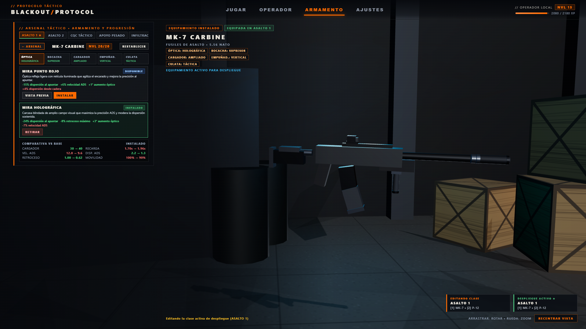
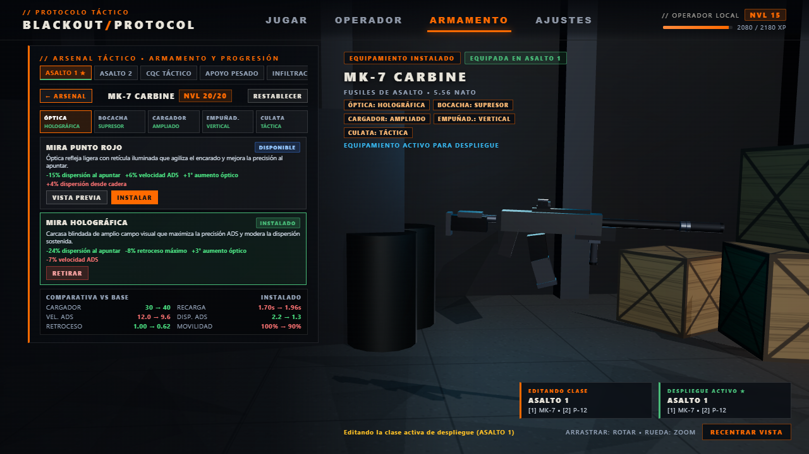
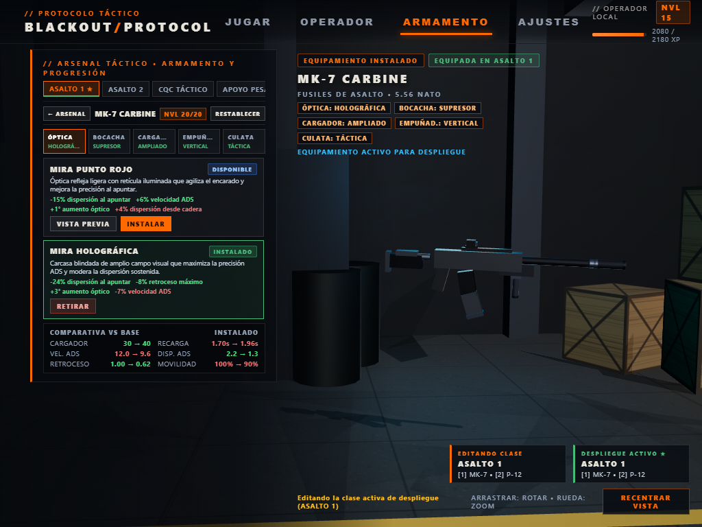
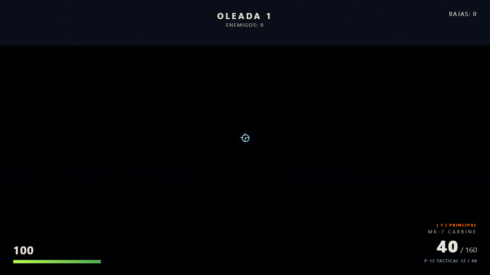

# BLACKOUT PROTOCOL — INFORME TÉCNICO DE SPRINT 7
## Sistema modular de accesorios, personalización en armero 3D, combate integrado y estabilidad WebGL
### Preparación de `v0.2.0-alpha`

- **Fecha:** 2026-11-11
- **Rama activa:** `develop`
- **Commit base de referencia:** `d2ecbd6` (`feat(armory): independent 3D showcase, category navigation bar, memory stabilization and adaptive framing (Sprint 6.1)`)
- **Rama protegida intacta:** `main` (`6a29c8c`) / versión pública `v0.1.0-alpha`
- **Archivos nuevos:** `js/attachments.js`, `js/attachment-visuals.js`, `tests/test_sprint7.mjs`, `docs/sprints/SPRINT_7_REPORT.md`, `docs/assets/screenshots/sprint7/*.png` (4 capturas de validación visual)
- **Archivos modificados:** `js/progression.js`, `js/weapon.js`, `js/audio.js`, `js/lobby.js`, `js/main.js`, `index.html`, `css/style.css`, `tests/run_all.mjs`, `tests/test_sprint6.mjs`
- **Estado de Git:** Cambios locales sin commit ni push en `develop`; árbol consistente y sin archivos temporales o capturas fuera de `docs/assets/screenshots/sprint7/`.
- **Restricciones verificadas:** Cero comentarios añadidos al código (`//`, `/* */` o `<!-- -->`), cero dependencias externas nuevas, `js/progression.js` libre de `import` externos para preservar `tests/test_progression_unit.mjs`, único `WebGLRenderer` compartido, cero fugas WebGL (**124/124 PASS** en `node tests/run_all.mjs`).

---

## 1. Resumen ejecutivo

El **Sprint 7** implementa de extremo a extremo el **sistema modular de accesorios y personalización de armas** para todas las plataformas jugables (`mk7`, `vector9`, `m870`, `p12`), conectando progresión, armero 3D interactivo, geometrías modulares compartidas/exclusivas, audio sintetizado y balística real en combate:

1. **Desacoplamiento estricto en 3 capas:**
   - `js/attachments.js`: catálogo completo (10 accesorios en 5 ranuras), matriz de compatibilidad por arma, desbloqueos por nivel de arma (1–20), contratos explícitos (`STAT_CONTRACTS`), composición multiplicativa con topes de seguridad (`resolveWeaponStats`), métricas UI (`getArmoryRatings`, `getAttachmentProsCons`, `compareWeaponStats`) y registro automático de reglas en `progression.js`.
   - `js/attachment-visuals.js`: tabla de anclajes 3D (`WEAPON_ATTACHMENT_ANCHORS`) por arma y ranura, modelos procedurales Three.js diferenciados para los 10 accesorios, propiedad explícita de geometrías compartidas (`SHARED_ATTACHMENT_GEOMETRIES` con `userData.shared = true`), liberación segura (`disposeNonSharedGeometries`) y montaje incremental (`applyAttachmentsToModel`).
   - `js/progression.js`: **Schema v3** (`SCHEMA_VERSION = 3`) con almacenamiento por equipamiento y por arma (`weaponAttachments`), migración idempotente `v1 -> v3` y `v2 -> v3`, revalidación tras registro de reglas (`registerAttachmentRules`) y aislamiento total respecto a módulos Three.js o navegador (`0` imports externos).
2. **Armero 3D y vista previa no destructiva (`index.html`, `css/style.css`, `js/main.js`, `js/lobby.js`):**
   - Modo `PERSONALIZAR` (`#armory-customizer`) con selector de 5 ranuras (`ÓPTICA`, `BOCACHA`, `CARGADOR`, `EMPUÑADURA`, `CULATA`), tarjetas de accesorios con beneficios/penalizaciones reales, estado (`INSTALADO`, `VISTA PREVIA`, `DISPONIBLE`, `BLOQUEADO`), comparativa numérica `VS BASE` en tiempo real y botón `RESTABLECER`.
   - Vista previa aislada (`VISTA PREVIA` / `QUITAR PREVIA` / `#btn-cancel-preview`) aplicable incluso a accesorios bloqueados en la exhibición 3D sin mutar la configuración guardada ni el despliegue activo; se limpia al salir de `PERSONALIZAR`, cambiar de arma, equipamiento, pestaña o iniciar partida.
   - Actualización incremental de la malla 3D en `#armory-showcase-stage` preservando `yaw`, `pitch` y `zoom` del usuario al equipar o previsualizar accesorios sobre la misma arma (`updateShowcaseBoundsFromWrapper`).
3. **Combate real y contrato de munición (`js/weapon.js`, `js/audio.js`, `js/main.js`):**
   - Las estadísticas efectivas y accesorios de arma principal y secundaria se calculan y congelan por ranura (`combatSession.slots.primary` y `combatSession.slots.secondary`) al iniciar cada partida (`startGame`).
   - Integración real de cargador ampliado y reserva proporcional, velocidad de recarga (`reloadDurationMult`, tanto de cargador como cartucho a cartucho en `m870`), alcance efectivo (`rangeMult`), dispersión cadera/ADS, retroceso/recuperación, velocidad ADS, movilidad, aumento óptico (`adsZoomOffset`), alineación de mira óptica sobre el eje ocular (`adsYOffset`), atenuación de fogonazo (`muzzleFlashMult`) y síntesis Web Audio suprimida (`audioSuppressed` en `playShotSynth`).

---

## 2. Arquitectura de módulos, contratos balísticos y matriz de accesorios

### 2.1 Separación de responsabilidades y contrato sin imports de `progression.js`

Para conservar la ejecución directa de `tests/test_progression_unit.mjs` sobre Node VM sin acoplar Three.js al estado persistente:
- `js/progression.js` expone `ATTACHMENT_SLOT_KEYS` (`['optic', 'muzzle', 'magazine', 'underbarrel', 'stock']`), `createEmptyAttachmentMap()` y `registerAttachmentRules(provider)`.
- Al cargarse `js/attachments.js`, este registra `{ getAttachmentById, canEquipAttachment, isAttachmentCompatible, isAttachmentUnlocked }` llamando a `registerAttachmentRules(...)`, lo que dispara inmediatamente `progression.revalidateAttachments()` sobre equipamientos cargados desde `bp_progression_v1`.
- Si un equipamiento contiene claves desconocidas, ranuras incompatibles con el arma o accesorios cuyo nivel de arma no alcanza `unlockWeaponLevel`, `revalidateAttachments()` los depura automáticamente preservando el resto de la configuración y las estadísticas base cuando ningún accesorio es válido.

### 2.2 Catálogo de accesorios, niveles de desbloqueo y compatibilidad (`js/attachments.js`)

| ID / Nombre | Ranura | Nvl. Arma | Armas Compatibles | Modificadores y Dirección de Efecto |
| :--- | :---: | :---: | :--- | :--- |
| `optic_reddot` (`MIRA PUNTO ROJO`) | `optic` | 3 | `mk7`, `vector9`, `m870`, `p12` | `adsSpeedMult: 1.06` (+6% vel. ADS), `spreadAdsMult: 0.85` (-15% disp. ADS), `adsZoomOffset: 26` (+1° aumento), `spreadHipMult: 1.04` (+4% disp. cadera) |
| `optic_holo` (`MIRA HOLOGRÁFICA`) | `optic` | 16 | `mk7`, `vector9`, `m870` | `spreadAdsMult: 0.76` (-24% disp. ADS), `recoilMaxMult: 0.92` (-8% techo retroceso), `adsZoomOffset: 28` (+3° aumento), `adsSpeedMult: 0.93` (-7% vel. ADS) |
| `muzzle_compensator` (`COMPENSADOR TÁCTICO`) | `muzzle` | 5 | `mk7`, `vector9`, `m870`, `p12` | `recoilKickMult: 0.82` (-18% retroceso/tiro), `recoilMaxMult: 0.85` (-15% techo), `adsSpeedMult: 0.96` (-4% vel. ADS), `spreadHipMult: 1.05` (+5% disp. cadera) |
| `muzzle_suppressor` (`SUPRESOR MONOLÍTICO`) | `muzzle` | 20 | `mk7`, `vector9`, `m870`, `p12` | `audioSuppressed: true`, `muzzleFlashMult: 0.22` (-78% fogonazo), `recoilKickMult: 0.88` (-12%), `spreadAdsMult: 0.88` (-12%), `rangeMult: 1.15` (+15% alcance), `adsSpeedMult: 0.91` (-9%), `mobilityMult: 0.97` (-3%) |
| `magazine_extended` (`CARGADOR AMPLIADO`) | `magazine` | 10 | `mk7`, `vector9`, `p12` | `magDeltaByWeapon`: `+10` (`mk7`), `+12` (`vector9`), `+4` (`p12`) con reserva proporcional; `reloadDurationMult: 1.15` (+15% tiempo recarga), `mobilityMult: 0.97` (-3%) |
| `magazine_fast` (`CARGADOR RÁPIDO`) | `magazine` | 16 | `mk7`, `vector9`, `p12` | `reloadDurationMult: 0.74` (-26% tiempo recarga), `adsSpeedMult: 1.04` (+4% vel. ADS), `spreadHipMult: 1.04` (+4% disp. cadera) |
| `underbarrel_vertical` (`EMPUÑADURA VERTICAL`) | `underbarrel` | 7 | `mk7`, `vector9` | `recoilKickMult: 0.83` (-17% retroceso), `recoilRecoveryMult: 1.12` (+12% recuperación), `adsSpeedMult: 0.95` (-5% vel. ADS) |
| `underbarrel_angled` (`EMPUÑADURA ANGULADA`) | `underbarrel` | 16 | `mk7`, `vector9` | `adsSpeedMult: 1.12` (+12% vel. ADS), `spreadHipMult: 0.86` (-14% disp. cadera), `recoilKickMult: 1.06` (+6% retroceso) |
| `stock_light` (`CULATA LIGERA`) | `stock` | 13 | `mk7`, `vector9`, `m870` | `mobilityMult: 1.06` (+6% movilidad), `adsSpeedMult: 1.09` (+9% vel. ADS), `recoilKickMult: 1.10` (+10% retroceso) |
| `stock_tactical` (`CULATA TÁCTICA`) | `stock` | 16 | `mk7`, `m870` | `recoilKickMult: 0.85` (-15%), `recoilRecoveryMult: 1.14` (+14%), `spreadAdsMult: 0.88` (-12%), `mobilityMult: 0.96` (-4%) |

> **Nota explícita de alcance sobre `muzzle_suppressor`:** En este sprint el supresor actúa sobre audio Web Audio (`audioSuppressed: true` -> `playShotSynth` reduce frecuencia de filtro paso bajo a `0.28×`–`0.65×`, amplitud de ruido a `0.42×`, tono a `0.55×` y duración a `0.78×`), fogonazo (`muzzleFlashMult: 0.22`), extensión física de boca (`MUZZLE_Z_EXTEND.muzzle_suppressor = 0.195`), dispersión ADS, retroceso y alcance. La detección acústica/sigilo de la IA enemiga queda explícitamente **fuera del alcance del Sprint 7** (`test_sprint7.mjs` Paso 15 valida el contrato físico/sonoro declarado sin simular sigilo de IA no implementado).

### 2.3 Contratos de composición y límites de seguridad (`STAT_CONTRACTS`, `resolveWeaponStats`)

Todas las duraciones, velocidades, tasas e intensidades operan mediante contrato unívoco en `STAT_CONTRACTS`:
- **Composición multiplicativa:** `spreadHip`, `spreadAds`, `recoilKick`, `recoilMax`, `recoilRecovery`, `reloadTime`, `adsSpeed`, `mobilityMultiplier`, `dropoff.optimal`/`dropoff.max` y `muzzleFlashMult` multiplican los factores de cada accesorio equipado sobre el valor base de `WEAPONS[id]`.
- **Recarga (`reloadDurationMult`):** Multiplica la **duración** de recarga (`< 1` recarga más rápido; `> 1` recarga más lento), corrigiendo cualquier ambigüedad entre velocidad y duración. En `m870` (`shellReload`), `shellReload.start`, `perShell`, `pump` y `end` escalan por la razón `weapon.reloadTime / WEAPONS.m870.reloadTime`.
- **Aumento óptico (`adsZoomOffset`):** Combina por máximo (`override_max`) frente al offset base `25°` (`75° - adsZoomOffset`), evitando degradación aditiva si en el futuro concurren múltiples ópticas.
- **Límites (`clamp`) aplicados en `resolveWeaponStats`:**
  - `spreadHip` ∈ `[0.0005, 0.2]` rad; `spreadAds` ∈ `[0.0002, 0.2]` rad
  - `recoilKick` ∈ `[0.15, 20]` pts; `recoilMax` ∈ `[0.5, 30]` pts; `recoilRecovery` ∈ `[1, 40]` pts/s
  - `reloadTime` ∈ `[0.35, 10]` s; `adsSpeed` ∈ `[4, 30]` 1/s; `mobilityMultiplier` ∈ `[0.65, 1.35]`×
  - `adsZoomOffset` ∈ `[15, 35]` °; `muzzleFlashMult` ∈ `[0.1, 2.0]`×

### 2.4 Coherencia de munición y aislamiento de partida

- `resolveWeaponStats` calcula el cargador efectivo `effMag = Math.max(1, Math.round(baseMag + magDelta))` y escala `reserveDefault` y `reserveSnd` proporcionalmente (`Math.round(baseReserve * (effMag / baseMag))`) cuando `magDelta !== 0`.
- `startGame(mode)` en `js/main.js` clona y congela `attachments` y `effectiveStats` para `combatSession.slots.primary` y `combatSession.slots.secondary`, inicializando `ammo = effStats.magSize` y `reserve` según el modo (`Waves` vs `S&D`).
- Los cambios de loadout o accesorios mientras la partida está en curso (`PLAYING` / `PAUSED`) nunca mutan la sesión activa ni duplican/pierden munición entre ranuras al alternar entre arma principal `[1]` y secundaria `[2]`; los nuevos accesorios aplican en el siguiente despliegue (`test_sprint7.mjs` Pasos 17 y 18).
- Asimismo, se blindó el temporizador de corredera `pump()` en `js/main.js` capturando `shotWpnId` y la referencia `pumpFn` antes de programar el `setTimeout(..., 280)` para impedir excepciones si el jugador cambia de arma o vuelve al lobby dentro de los `280 ms` posteriores a un disparo con `m870`.

---

## 3. Modelos 3D modulares, encuadre y propiedad de recursos WebGL (`js/attachment-visuals.js`, `js/weapon.js`, `js/lobby.js`)

### 3.1 Anclajes, sustitución de piezas base y alineación ADS

En `js/weapon.js`, las mallas por defecto intercambiables en `buildMK7`, `buildVector9`, `buildM870` y `buildP12` reciben `userData.partRole` (`optic_default`, `sight_front`, `muzzle_default`, `magazine_default`, `stock_default`). Cuando `applyAttachmentsToModel(modelRoot, weaponId, attachmentMap, options)` monta un accesorio en una ranura cuyo anclaje declara `hides`, oculta automáticamente dichas piezas base sin destruirlas, de forma reversible al retirar o cancelar la vista previa.

| Arma | Óptica (`pos` / `adsYOffset` / oculta) | Bocacha (`pos` / oculta) | Cargador (`pos` / `rot` / oculta) | Empuñadura (`pos`) | Culata (`pos` / oculta) |
| :--- | :--- | :--- | :--- | :--- | :--- |
| `mk7` | `[0, 0.075, -0.06]` · `0.064` · `optic_default`, `sight_front` | `[0, 0.012, -0.735]` · `muzzle_default` | `[0, -0.14, -0.04]` · `[0.18, 0, 0]` · `magazine_default` | `[0, -0.08, -0.33]` | `[0, -0.01, 0.19]` · `stock_default` |
| `vector9` | `[0, 0.078, -0.05]` · `0.06` · `optic_default` | `[0, 0.018, -0.47]` · — | `[0, -0.22, -0.16]` · `[-0.12, 0, 0]` · `magazine_default` | `[0, -0.021, -0.27]` | `[0, 0.01, 0.11]` · `stock_default` |
| `m870` | `[0, 0.0625, -0.04]` · `0.078` · — | `[0, 0.038, -0.8]` · — | *No compatible* | *No compatible* | `[0, -0.015, 0.22]` · `stock_default` |
| `p12` | `[0, 0.0475, 0.0]` · `0.085` · `optic_default` | `[0, 0.015, -0.29]` · — | `[0, -0.155, 0.055]` · `[-0.28, 0, 0]` · — | *No compatible* | *No compatible* |

En primera persona, `applyAttachmentsToModel` retorna `adsYOffset` para centrar la retícula del visor (`GUN_ADS_BASE.y + vis.adsYOffset`) sobre el centro exacto de pantalla al apuntar, y `muzzlePosOverride` desplaza `gunGroup.userData.muzzlePos` hasta la punta real de `muzzle_compensator` (`-0.088 × scale`) o `muzzle_suppressor` (`-0.195 × scale`).

### 3.2 Contrato de propiedad de geometrías WebGL (compartidas vs. exclusivas)

- **Geometrías compartidas a nivel de módulo (`userData.shared = true`):** `SHARED_RETICLE_DOT_GEO` (`SphereGeometry(0.0014, 6, 6)` exportada en `SHARED_ATTACHMENT_GEOMETRIES`) y los materiales compartidos de `attachment-visuals.js` permanecen residentes durante toda la sesión y **nunca** se liberan al desmontar o alternar armas.
- **Geometrías exclusivas de instancia (`userData.shared` falsy):** Cada malla procedural de accesorio reconstruida al cambiar una ranura en `applyAttachmentsToModel` se desacopla de su contenedor por ranura y pasa por `disposeNonSharedGeometries(ch)`, recolectando en un `Set` todas las geometrías no compartidas antes de invocar `.dispose()`.
- **Protección global de jerarquías (`js/weapon.js`):** `disposeHierarchyGeometries(root)` respeta igualmente `!g.userData?.shared` al desmontar armas del jugador, operador del lobby o exhibición 3D.
- **Validación por estrés real en WebGL (`test_sprint7.mjs` Paso 19):** Tras 36 cambios rápidos de accesorios entre ranuras y 4 ciclos completos de partida en Oleadas y regreso al lobby, `renderer.info.memory.geometries` y `renderer.info.memory.textures` permanecen **<= línea base** y `areSharedAttachmentGeometriesIntact()` confirma la integridad continua de `SHARED_ATTACHMENT_GEOMETRIES`.

---

## 4. Validación visual (capturas reales en Playwright/Chrome)

Capturas generadas automáticamente tras la última edición (`node tests/test_sprint7.mjs`, Paso 20) en todas las resoluciones objetivo sin recorte del modelo 3D, sin solapes del personalizador y con retícula holográfica centrada en combate ADS:

### Personalizador `ARMAMENTO` con 5 accesorios instalados en `MK-7 CARBINE`

- **Desktop Full HD (`1920×1080`):**  
  

- **HD estándar (`1280×720`):** ambas tarjetas visibles íntegramente junto con comparativa `VS BASE` y exhibición 3D completa:  
  

- **Viewport compacto (`1024×768`):** cabecera `MK-7 CARBINE` completa sin truncamiento, sin desbordamiento horizontal y con modelo 3D íntegro:  
  

### Combate en primera persona (`ADS` con `optic_holo` + `magazine_extended` en `1280×720`)

- Carcasa holográfica y retícula cian alineadas al centro de pantalla y HUD de munición ampliada (`40 / 160` en principal y `12 / 48` en secundaria `P-12 TACTICAL`):  
  

---

## 5. Resultados de pruebas automatizadas (`124/124 PASS`)

Ejecución íntegra de `node tests/run_all.mjs` posterior a la última edición del proyecto:

| Suite | Pruebas | Estado | Duración | Cobertura verificada |
| :--- | :---: | :---: | :---: | :--- |
| `test_progression_unit.mjs` | 6/6 | **PASS** | 0.0 s | Fórmulas XP, curvas jugador `1-50` / armas `1-20`, persistencia y catálogo sin imports externos |
| `test_progression_browser.mjs` | 7/7 | **PASS** | 21.9 s | Cabecera lobby, categorías de armamento, XP en Oleadas/S&D y recarga |
| `test_sprint3.mjs` | 10/10 | **PASS** | 10.1 s | Navegación de lobby táctico, camuflajes, pausa y responsividad |
| `test_engine_lifecycle.mjs` | 14/14 | **PASS** | 41.0 s | Ciclo de vida motor, pausas, muerte/reintento, S&D y 10 ciclos de estabilidad |
| `test_sprint5.mjs` | 20/20 | **PASS** | 21.9 s | Armamento modular (`mk7`, `vector9`, `m870`), curvas de daño, caída y memoria |
| `test_sprint5_closure.mjs` | 5/5 | **PASS** | 7.5 s | Cadencia a 30/60/120 FPS, impactos mixtos `M870`, recarga interrumpible y 20 swaps |
| `test_memory_deep.mjs` | 6/6 | **PASS** | 16.1 s | Acumulador temporal, anti-ráfaga en pausa/lag, 20 swaps, 10 Oleadas, 10 S&D y retry |
| `test_sprint6.mjs` | 22/22 | **PASS** | 23.5 s | 5 equipamientos personalizados, migración v1->v2/v3, `P-12 Tactical`, cambio `[1]/[2]` y regresión |
| `test_sprint6_1.mjs` | 14/14 | **PASS** | 70.0 s | Exhibición 3D independiente, barra de categorías tácticas, ausencia de scroll vertical y estabilidad |
| `test_sprint7.mjs` | 20/20 | **PASS** | 31.0 s | Catálogo, regresión base cero, matemáticas/límites, desbloqueos por nivel, 5 equipamientos v3, migraciones y corrupción, UI `PERSONALIZAR`, ranuras incompatibles, cancelación de `VISTA PREVIA`, actualización 3D incremental con ángulo preservado, encuadre sin recortes, combate real (`mk7`, `vector9`, ópticas ADS, supresor audio/fogonazo, `m870` recarga por cartucho/culata, `p12` secundaria), inmunidad en partida, memoria WebGL (`36 swaps + 4 partidas`) y capturas responsivas `1920/1280/1024` |
| **TOTAL GLOBAL** | **124/124** | **PASS (100%)** | — | **Cero fallos, cero regresiones y cero errores JS/WebGL en consola** |

---

## 6. Verificación de higiene e inventario final de Git

- **Auditoría de comentarios:** Escaneo completo con `rg` sobre `js/attachments.js`, `js/attachment-visuals.js`, `tests/test_sprint7.mjs` y todas las líneas añadidas en `git diff` -> **0 coincidencias**.
- **Ramas:** Trabajo localizado exclusivamente en `develop`; `main` (`6a29c8c`) y `remotes/origin/main` intactas; sin `git commit`, sin `git push` y sin publicación de versión ni inicio de Sprint 8.
